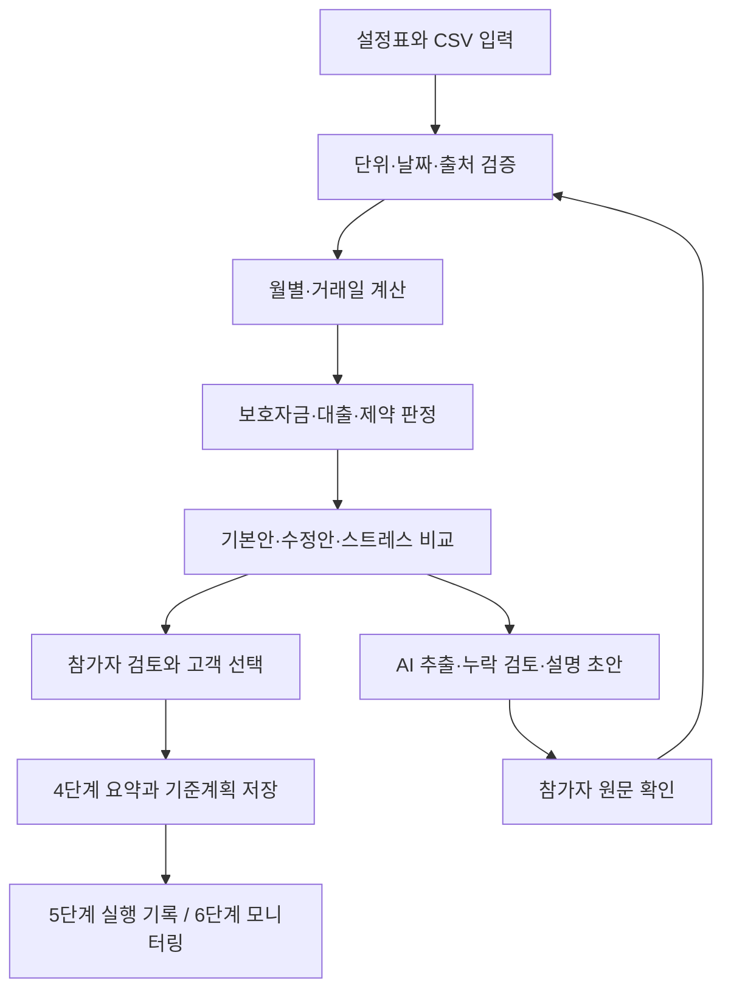

# AFPK 공모전 4단계 계산 및 대안 비교 시스템 구현 계획

작성·자료 확인일: 2026-11-13 KST  
대상: AFPK 영 플래너 챌린지 2026 B안 가상 고객 사례  
목적: Google Docs, 공식 참가작 DOCX, `hw`의 설정·계산·보완자료를 연결해 4단계에서 무엇을 어떤 순서로 구현할지 정한다.

## 1. 먼저 정할 결론

**4단계는 최초 재무설계안을 계산하고 비교해 권고 근거를 만드는 도구로 구현한다.** 기존 Python 계산을 입력·계산·판정·보고서 생성으로 나누고, 월별 장부와 계약·잔금일 자금표를 같은 입력에서 만든다. 그 결과를 5단계 실행과 6단계 모니터링의 기준계획으로 전달한다.

원문 「1104 규리 - 재무설계 프로세스와 AI」는 4단계를 간단한 코드로 해결하고, 입력 화면·저장·경보·변경 이력을 갖춘 시스템은 6단계에 집중한다고 명시한다. 따라서 이 문서에서 말하는 ‘4단계 시스템’의 우선 산출물은 **재현 가능한 계산 패키지, 대안 비교표, 판단·검증 기록, 기준계획 파일**이다. 별도 웹사이트는 필수 범위에 넣지 않는다. 6단계 화면에서도 쓸 수 있도록 계산 함수를 분리한다. [G2]

현재 자료만으로 확정할 수 있는 방향은 다음과 같다.

- 회복·진료·필수 돌봄과 비상현금을 먼저 지키고, 은퇴저축 월 100만 원을 유지하면서 주택가격·시점 등을 조정한다.
- 2027년·2030년·2031년의 7.5억 원 대안을 재현한다. 2027년 안은 계약일 보호자금 부족, 나머지도 구입 후 보호자금 유지에 문제가 있다.
- **2031년 6.3억 원·대출 2억 1,700만 원은 ‘추가 검토 대안’이다.** 구완성본의 조건부 권고 표현을 현재 결론으로 사용하지 않는다.
- 5단계의 ‘2031년 6억 원 수준’과 6단계의 ‘5.6억 원’은 연결해서 검토할 후보다. Google Docs에 제시된 6단계 수치는 있으나, 이번 작업에서는 해당 장부와 계산 코드를 독립 재현하지 않았다. 승인된 4단계 최종안으로 옮기지 않는다.
- 최종 매입안이 아직 없어도 출산 준비·비상현금 구분·은퇴저축은 먼저 실행할 수 있다. 주택 계약 승인은 별도 조건으로 둔다.

이 문서는 **구현 설계서**다. 기존 계산의 재현 여부와 앞으로 만들 기능을 구분한다. Google Docs와 기존 파일은 수정하지 않았다.

## 2. 공모전과 고객 사례를 어떻게 이해했는가

### 2.1 공식 DOCX가 요구하는 것

루트의 `IFPK_AFPK+영플래너+챌린지+2026_참가작+양식(본문+부록)_최종.docx`는 공식 제출 양식이다. 고객 수치가 채워진 별도 보고서가 아니다. [L0]

| 항목 | 양식에서 확인한 조건 | 이 구현에 반영할 사항 |
|---|---|---|
| 본문 | A4 7~14매, 범위 이탈 시 감점 | 4단계는 전체 6단계 중 일부다. 상세 장부와 본문 요약을 분리한다. |
| 개인정보 | 본문에 참가자 성명·학교명 등 포함 시 심사 제외 | 참가자 식별정보를 제거한다. 가상 고객 이름과 구분한다. |
| 재무설계 과정 | 6단계가 하나의 사례로 이어져야 함 | 동일 입력·계획 ID를 2~6단계에 사용한다. |
| 4단계 | 재무설계안 수립 및 제시 | 대안, 정량 비교, 선택 이유와 조건을 출력한다. |
| 판단 근거 | 표·계산식·참고자료, 인용 출처는 각주 | 모든 핵심 수치에 입력·산식·출처를 연결한다. |
| 제도 | 세법·법률·규정은 현행 적용 | 과거 사례 재현과 제출용 현행 확인을 별도로 관리한다. |
| AI 부록 | A4 3~10매, 미제출 시 심사 제외 | 도구·실제 프롬프트·응답·참가자 판단·검증·수정을 기록한다. |
| 별도 AI 도구·앱 | 해당 없으면 관련 항목 생략 가능 | 앱 제작 자체를 공식 필수 요건으로 해석하지 않는다. |

양식의 Claude·Opus 5·Max, 예시 프롬프트, 적금 계산 사례는 삭제 대상 예시다. 프로젝트의 실제 도구·버전·성과로 사용하지 않는다. 배점·마감일·필수 기술 스택은 이 양식에서 확인되지 않았다.

### 2.2 사례의 핵심 문제

김도윤·이서연은 결혼 2년 차 맞벌이 부부다. 남편은 만 34세 대기업 IT 개발자, 아내는 만 32세 지방직 공무원이다. 경기권 전세에 살며 첫 자녀 출산은 2028년 4월, 최초 주택 목표는 2030년 6월 7.5억 원이다. 부부는 각각 만 60세 은퇴를 희망한다. [G4, G5, L1]

아내의 정기 진료와 출산 후 회복, 양가의 정기 육아 지원이 어려운 여건 때문에 유료 가사·돌봄비를 실제 예산에 넣었다. 집을 사기 위해 필요한 의료·돌봄을 자동 삭감하면 사례의 우선순위를 위반한다. 평균적인 가구를 그대로 재현하는 모델이 아니라, 근거와 팀의 선택을 구분한 가상 고객 사례다.

분석 질문은 ‘집값을 얼마나 낮추면 숫자가 맞는가’에서 끝나지 않는다. **출산·휴직을 거치면서 계약금을 제때 내고, 잔금 이후에도 보호자금과 은퇴저축을 유지할 수 있는 주택 조건은 무엇인가**를 비교해야 한다.

### 2.3 단계별 책임

| 단계 | 입력 또는 판단 | 4단계와 연결되는 산출물 |
|---|---|---|
| 1~2단계 | 고객·목표·우선순위·자료수집 | 출처와 기준일이 있는 입력표 |
| 3단계 | 현재 재무상태·목표 충돌·핵심 위험 분석 | 비교할 제약과 평가 지표 |
| 4단계 | 최초 대안 계산·스트레스 검증·권고 | 비교표, 권고 또는 보류 이유, 기준계획 |
| 5단계 | 자동이체·지원 신청·거래 등 실제 실행 | 계획과 구분된 실행일·금액·증빙 |
| 6단계 | 실제 변화 감지·재계산·경보·수정 승인 | 새 계획 버전과 변경 이력 |

4단계의 스트레스는 최초 계획의 취약성을 확인한다. 6단계는 실제 변경이 들어왔을 때 같은 계산을 다시 실행하고 차이·원인·대응을 기록한다. 목표나 우선순위 자체가 바뀌면 4단계 재수립 여부를 사람이 정한다. 주택 구입 전에도 5단계 실행과 6단계 점검은 시작할 수 있다. [G2, G7~G9]

## 3. 자료 충돌과 적용 기준

파일명에 ‘최종’이나 ‘완성본’이 있어도 후속 검증과 충돌하면 그대로 채택하지 않는다. 계산 입력은 1107 설정표, 보완 가정은 계산부록, 현재 판단은 피드백 반영본과 장기 보완검증을 함께 사용한다. 1110의 수정 제안은 후속 작업 지시로 읽으며, 계산을 생략하고 확정값으로 올리지 않는다.

| 충돌 | 자료의 차이 | 설계서의 처리 |
|---|---|---|
| 생활비·저축 여력 | 1~3단계 ‘최종’ 탭은 생활비 450·주택/출산저축 300, 1107 및 4단계는 480·270 | 계산 기준은 480·270. 보고서 2~3단계에도 같은 기준을 반영해야 한다. |
| 육아휴직 기간 | 일부 4단계 표의 2028.7~2029.5는 11개월 | 휴직은 2029.6까지 12개월. 6월은 어린이집 적응·휴직이 겹치는 전환월이다. |
| 비상현금 정의 | 초기 문구는 ‘필수생활비’, 후속 문구는 생활·돌봄비 기준 | 생활·돌봄비를 포함하고 취득 후 원리금도 반영한다. 은퇴저축은 6개월분 산정에서 제외한다. |
| 6.3억 안의 지위 | 구완성본·보고서 생성기는 조건부 권고, 후속 본문·부록은 추가 검토 대안 | 후속 판정을 사용한다. 구권고 문구가 자동 재생성되지 않게 한다. |
| 6억·5.6억 연결 | 5·6단계 서사와 비교 수치는 있으나 로컬 4단계 장부는 주로 6.3억 | 별도 후보/6단계 시연값으로 표시하고 계산 재현 전 최종안 등록을 막는다. |
| 정산 유보 전후 잉여 | 2029.6 약 26과 약 21이 혼재 | 총현금 증가 약 26, 정산 유보 5 차감 후 신규 배분 가능액 약 21로 구분한다. |
| 분석 종료 | 공통 비교시점 2031.6만 보면 2031 매입 직후가 없음 | 공통시점 비교와 각 안의 매입 후 5년 검증을 둘 다 출력한다. |
| 중복 부록 | 루트와 `hw`의 보완검증 MD 내용 동일 | `hw` 파일을 참조 기준으로 삼는다. 두 개의 독립 검증 근거로 세지 않는다. |

현재 자료의 제도·지원액은 주로 2026-11-07 설정의 재현값이다. **그 값이 2028~2036년에 실제 적용된다는 뜻은 아니다.** `historical_replay`는 기존 수치 재현, `working_plan`은 실행일에 유효한 확인자료로 계산하는 모드로 나눈다. 후자에서 미확인 제도·대출·날짜는 `UNKNOWN`으로 남긴다.

이번에 외부 원문을 추가 확인한 것은 취득세 일반세율 안내다. 나머지 휴직수당·기여금·지원금·대출규제·감면·증여 요건을 모두 현행 검증했다고 표시하지 않는다. 제출 전 제도별 시행일·적용일·확인 출처를 채워야 한다. [W1]

## 4. 기준 입력과 날짜

별도 표시가 없으면 금액 단위는 **만 원**이다. 기존 모델과 수치 대조할 때도 같은 단위를 쓴다.

### 4.1 자산·소득·목표

| 항목 | 기준값 | 계산상 의미 |
|---|---:|---|
| 기준 잔액일 | 2026.11 말 | 첫 계산월은 2026.12. 11월 저축을 중복 가산하지 않음 |
| 현금·예적금 | 8,000 | 즉시 현금으로 계산하는 기존 모델 가정 |
| 주식·ETF | 2,500 | 각 계약 전월 말 결제 완료 매각 가정. 실제 결제·세금·수수료는 별도 확인 |
| 사적 연금자산 | 1,500 | 주택자금에 쓰지 않음. 매월 100 추가 납입 |
| 전세보증금·대출 | 30,000 / 10,000 | 반환 시 순유입 20,000. 현재 계약금 재원으로 사용 불가 |
| 현재 총자산·부채·순자산 | 42,000 / 10,000 / 32,000 | 전세 순지분으로 표시할 때 대출을 다시 차감하지 않음 |
| 남편·아내 세후 월소득 | 570 / 280 | 합계 850. 성과급·임금상승은 기본 0 |
| 현재 생활비·은퇴저축 | 480 / 100 | 출산·주택에 배분 가능한 현재 월액은 270 |
| 부모 지원 | 각자 부모→각자 자녀 5,000씩, 총 10,000 | 각 매입연도 5월 말 수령 설정. 미입금분은 현재 자산 아님 |
| 비상현금 시작 목표 | 3,100 | 기존 자산 안의 용도 지정. 이후 물가·지출·원리금에 따라 재계산 |
| 출산 준비현금 | 1,500 | 1,380 예정지출+120 여유의 2026년 가격 배정. 새 자산·추가 지출 아님 |
| 주택 기본 비교 | 2027.6 / 2030.6 / 2031.6, 각 75,000 | 각 시점 명목가격 가정. 동일 주택의 가격 예측 아님 |
| 주담대 기본·스트레스 | 연 5% / 7%, 30년 원리금균등 | 실제 승인액·상환방식·첫 납입일 확인 전 분석 가정 |
| 물가·투자수익 | 생활·돌봄·출산비 연 2%, 투자수익 0 | 급여·현금지원·명목 이자·원리금에는 물가를 중복 적용하지 않음 |

부모 지원의 세금 0은 각 수증자가 과거 10년 공제를 사용하지 않았다는 원설정 전제다. 실제 증여 이력·관계·신고를 확인하기 전 확정 세금으로 처리하지 않는다. 출산가구 취득세 감면은 기본 계산에서 제외한다. [L1~L4]

### 4.2 생애주기별 생활비와 소득 전환

| 구간 | 생활·돌봄비의 2026년 가격 구성 | 아내 소득 및 추가 처리 |
|---|---|---|
| 현재~2027.11 | 성인 480 | 세후 280 |
| 2027.12~2028.3 | 성인 480+출생 전 아이 보험 8 | 세후 280. 출생 후 보험은 아이 80 안에 포함 |
| 2028.4~5 | 실제 성인·아이 비용과 집중지출을 구분 | 출산휴가 실수령 280 가정. 원모델 재현은 성인 405+아이 80, 식비·청소 감액 0 |
| 2028.6 | 성인 405+아이 80=485 | 출산휴가 실수령 280 가정 |
| 2028.7~2029.5 | 405+80+보조 돌봄 20=505 | 휴직 1~3개월 250, 4~6개월 200, 7~12개월 160 |
| 2029.6 | 405+아이/어린이집 90+공백 돌봄 60=555 | 휴직 12개월차 160. 어린이집 적응 시작 |
| 2029.7 이후 | 555 | 복직 후 세후 280 |
| 자가 취득 이후 | 위 비용에서 전세이자 30 제거, 자가 유지비 10 추가 | 주담대 원리금 별도 차감 |

휴직 중에는 기여금 31.5를 실제 현금지출로, 정산 유보 5를 현금 내부 목적자금으로 구분한다. 기본 휴직 기여금 합계는 378, 정산 유보 합계는 60이다. 복직 6개월 지연 스트레스는 2030.1 복직, 추가 수당 0이라는 **해당 시험의 가정**이다. 어린이집·회복지원 돌봄은 유지하고, 부모급여 가정양육 현금을 되살리지 않는다.

### 4.3 출산 집중지출과 지원

| 지출 | 2026년 가격 | 배치 |
|---|---:|---|
| 임신 전 점검·상담 | 50 | 2027.4~6 균등 |
| 산전진료 | 150 | 2027.8~2028.3 균등 |
| 분만·입원 별도 부담 | 100 | 2028.4 |
| 조리원 | 500 | 2027.12 예약 50, 2028.4 잔금 450 |
| 산후도우미 | 330 | 2028.3 예약 75, 2028.5 잔금 255 |
| 초기 육아용품 | 250 | 2028.2·3 각 125 |
| 합계 | 1,380 | 지급월별 물가 적용 후 약 1,417 |

임신·출산 진료비 바우처 100은 적격 산전진료, 첫만남이용권 200은 발급 후 조리원 잔금 일부에 사용하는 기존 가정이다. 둘 다 현금입금이 아니다. 물가 반영 후 현금부담은 약 1,117이다. 발급 지연·적격 사용처·사용기한은 날짜별 장부에서 다시 확인한다.

현금지원은 2028.4~2029.3 월 110, 2029.4~5 월 60, 2029.6부터 월 10으로 원모델을 재현한다. 55개월 구간의 합계는 1,690이다. 이 마지막 10을 자녀 연령 확인 없이 장기간 연장하지 않는다. 경기도·시군 지원, 도우미 보조금 등 미승인 지원은 자동 가산하지 않는다.

### 4.4 거래 일정과 보호자금

기존 모델의 계약일은 각 매입연도 **3월 15일**, 잔금일은 **6월 15일**, 계약금은 매매가의 10%, 잔금은 90%다. 계약일에는 2월 말 잔액, 잔금일에는 5월 말 잔액과 당일 순보증금·대출만 쓸 수 있다고 가정했다. 해당 월 급여를 먼저 쓰지 않는다. 중도금은 원계약 가정에 없으며, 실제 계약에 있으면 별도 사건으로 추가한다.

주담대는 취득월부터 월납입 전액 1회, 부대비용은 잔금일 전액 지출이라는 근사다. 날짜별 구현에서는 급여일·수수료 선지급·대출 실행·보증금 반환·첫 납입일과 같은 날의 처리 순서까지 입력받는다.

보호자금은 비상현금, 미집행 출산비의 순현금부담, 출산 여유, 정산 유보, 거래 여유로 나눈다. 출산 여유 120은 기존 재현에서 물가를 적용하고 2028.5 집행 종료 후 해제한다. 거래 여유 200은 취득일부터 현금으로 보유한다. **200은 부대비용 지출에 다시 더하지 않는다.**

## 5. 4단계 관련 요구사항을 기능으로 정리

다음은 원문에서 추출한 범위를 구현 가능한 작업으로 정리한 것이다. 함수명·파일명·결과 상태는 이 문서의 구현 제안이다.

| ID | 기능 | 필요한 처리 | 확인할 산출물 |
|---|---|---|---|
| REQ01 | 입력 통합 | 고객·재무·목표·날짜·제도·가정·출처를 한 입력으로 관리 | 검증된 입력 JSON, 입력 대조표 |
| REQ02 | 입력 검증 | 단위, 잔액일, 월 범위, 중복 거래, 누락값, 명목/실질 구분 | 오류·미확인 목록 |
| REQ03 | 월별 계산 | 소득·휴직·지원·생활·돌봄·출산·은퇴저축·대출 반영 | 월별 장부 |
| REQ04 | 날짜별 유동성 | 계약·중도금·잔금·반환·대출·비용의 지급 순서 계산 | 거래일 자금표 |
| REQ05 | 자산·현금 구분 | 바우처, 유보금, 연금이체, 매각, 증여, 보증금 반환 처리 | 현금·자산·부채 보존 대조 |
| REQ06 | 보호자금 | 각 항목 잔액과 비상목표를 매 시점 재산정 | 보호자금 구성표·보호여유 |
| REQ07 | 거래비용 | 가격·면적·세율 조건별 비용, 지급일·감면 상태 관리 | 비용 명세 |
| REQ08 | 필요 대출 역산 | 대출 변화에 따른 원리금·비상목표 재계산, 해 유무 검증 | 필요대출과 승인액 비교 |
| REQ09 | 대안 비교 | 2027/2030/2031, 가격 수정안, 전세 유지안 비교 | 동일 열의 비교표 |
| REQ10 | 스트레스 | 단일 충격 후 복합 충격, 기본 대출 고정 | 스트레스별 최초 위반·부족액 |
| REQ11 | 판정 | 지급불능·보호자금·고객 합의 상환부담·월적자·미확인·미평가 구분 | 규칙별 결과와 근거 |
| REQ12 | 수정안 탐색 | 고객 허용 범위 안에서 가격·시점·배분 변경 | 검증한 후보와 탈락 이유 |
| REQ13 | AI 보조 | 자료 추출, 코드·설명 초안, 비용 누락·취약가정 검토 | 원문 위치와 사람의 확인 기록 |
| REQ14 | 4.5 권고 연결 | 최종안·예비안 또는 보류, 이유·성립조건·후속 행동 | 4단계 본문용 요약 |
| REQ15 | 기준계획 전달 | 입력·규칙·기간·결과·선택 이유를 고정 저장 | 5·6단계가 읽을 기준계획 |
| REQ16 | AI 부록 증빙 | 실제 도구·프롬프트·응답·검증·수정 내역 저장 | 공식 양식에 대응하는 기록 |

4단계 필수 범위는 REQ01~REQ16의 파일 기반 처리다. 이 기능 ID는 1107 설정표의 출처 R01~R22와 별개다. 계좌·금융거래 자동 실행, 실시간 은행 연동, 무인 정책 수집, 광범위한 상품 추천은 별도 작업이다. 자료 변화 수집·월별 실제값 저장·경보 확인/해결 상태·계획 변경 이력의 서비스 화면은 6단계에서 연결한다.

## 6. 기존 자산을 어떻게 재사용할 것인가

| 현재 파일 | 이미 있는 기능 또는 자료 | 재사용 방법과 주의점 |
|---|---|---|
| `verify_plan.py` | 월별 현금·보호자금·주담대·거래일·스트레스, 대출 역산 | 원모델 재현 기준으로 보존하고 계산 함수를 분리한다. 현재는 하드코딩된 한 가구 모델이다. |
| `feedback_audit.py` | 매입 후 5년 연장, 최초 적자·보호기준 위반, 대출 경계 검증 | 최신 보완 결과의 재현 근거. 최상위 실행 시 CSV·MD를 쓰므로 읽기 전용 검사에서는 그대로 실행하지 않는다. |
| `build_report.py` | JSON·CSV에서 설명·표 생성 | 출력 구조를 참고한다. 구권고 문구를 포함하므로 현재 판단을 직접 생성하는 엔진으로 쓰지 않는다. |
| `계산결과.json`, 월별·거래일 CSV | 세 기본안의 기존 결과 | 회귀 비교용으로 고정한다. 새 계산 결과가 다르면 입력·규칙 변경 이유를 남긴다. |
| `권고안결과.json`, `권고안_*` CSV | 6.3억 기본·단기 복합 결과 | 파일명의 ‘권고안’을 현재 승인 상태로 해석하지 않는다. |
| `보완검증_연장결과.json`, `보완검증_*` CSV | 장기 반례, 거래일 보호자금, 대출 경계 | 현재 판정에 반드시 함께 사용한다. |
| `가격조정대안.csv`, `스트레스테스트.csv` | 일부 가격 수정안·여러 충격 결과 | 원기간·대출액·충격 집합을 확인한 뒤 비교한다. |
| 두 ZIP 파일 | 보고서·검산자료 묶음 | 전달·이력 참고용. 폴더의 후속 수정본보다 자동 우선하지 않는다. |

현재 코드에서 먼저 해결할 한계는 다음과 같다.

1. `min_cash`, `min_free`는 월말 `rows`만 집계한다. 계약일·잔금일 사건을 합쳐 최저점과 최초 위반을 구해야 한다.
2. `solve()`는 계약일을 제외하고 잔금일~2031.6의 보호여유를 역산한다. 미래 대출을 계약일에 쓰면 안 된다. 계약일 실패를 별도 실패로 반환한다.
3. 이분탐색에는 상한 미통과, 해 없음, 비단조 가능성, 실제 승인한도 처리가 없다. 무조건 숫자를 반환하는 구조를 고친다.
4. `pmt()`는 0금리 처리가 없고, `costs()`는 6~9억·일반세율 가정의 좁은 함수다. 5.6억·5.8억 후보를 그 함수에 그대로 넣을 수 없다.
5. 현재 계약·잔금 2개 사건만으로는 실제 급여일·중도금·바우처 발급·정산 납부·동일일 입출금 순서를 검증할 수 없다.
6. 매입 후 5년 연장은 급여·양육 구성·지원 10을 고정한 민감도다. 아동 연령·취학·지원 종료를 반영한 실제 장기 예산이 아니다.
7. 은퇴저축 월 100 유지 여부는 계산하지만 은퇴자금 충분성은 계산하지 않는다. 노후 충분성은 `NOT_EVALUATED`로 둔다.
8. `verify_plan.py`와 `build_report.py`가 구권고 표현을 재생성할 수 있다. 결과 객체의 판정을 보고서·CSV·JSON이 공통으로 읽게 한다.

기존 스크립트의 수치 재현과 원가정의 현실 적합성은 다른 검증이다. 수치가 맞아도 실제 승인·지원 적격성·송금·임대차 합의가 확인되지는 않는다.

## 7. 구현 구조와 데이터 계약

### 7.1 가장 작은 실행 흐름



Python 표준 라이브러리와 JSON·CSV로 우선 구현한다. 별도 서버·DB 없이 재현 패키지를 만들고, 6단계에서 원문 제안인 Streamlit 입력·비교 화면과 SQLite 이력을 붙일 수 있다. 특정 라이브러리 버전은 구현 시 공식 문서와 실행환경을 확인해 고정한다. [G9]

다음 구조는 **앞으로 만들 파일 구조 제안**이다. 현재 이 파일들이 구현되어 있다는 뜻은 아니다.

```text
hw/stage4/
  inputs/case.json             # 고객·목표·잔액·가정·출처
  inputs/events.csv            # 실제 또는 가정된 사건과 처리 순서
  inputs/policy_rules.json     # 시행일·적용일·확인상태가 있는 규칙
  inputs/scenarios.json        # 기준안 대비 변경분만 기록
  engine/cashflow.py           # 월별·사건별 현금과 자산
  engine/mortgage.py           # 원리금·상환표·역산
  engine/costs.py              # 범위와 요건이 명시된 비용
  engine/life_stage.py         # 연령별 지원·양육·교육·돌봄 일정
  engine/retirement.py         # 자료 확보 후 추가할 장기 노후 분석
  engine/constraints.py        # PASS/FAIL/UNKNOWN/NOT_EVALUATED
  engine/compare.py            # 후보 비교와 탐색
  report.py                   # 같은 결과 객체에서 표·MD 출력
  run.py                      # 입력 검증 → 계산 → 산출물 저장
  outputs/<run_id>/            # 실행별 입력 스냅샷·결과·검증기록
  tests/                      # 아래 인수 기준을 확인하는 계산·판정 검사
```

### 7.2 입력 스키마

| 객체 | 필수 필드 | 의미 |
|---|---|---|
| `case` | `case_id`, `schema_version`, `as_of_date`, `currency`, `amount_unit` | 사례와 금액 단위의 기준 |
| `input_value` | `key`, `value`, `unit`, `price_base_month`, `effective_from`, `effective_to`, `source_id`, `value_kind`, `verification_status`, `checked_at` | 값의 성격과 확인 상태를 별도로 보존 |
| `source` | `source_id`, `kind`, `path_or_url`, `locator`, `checked_at`, `effective_date` | 문서 탭·절·법령 조문 등 위치 |
| `event` | `event_id`, `date`, `sequence`, `type`, `amount`, `account_from`, `account_to`, `source_id`, `record_kind`, `planned_event_id`, `verification_status` | 동일일 순서·계획/실제·원계획 연결과 자산 이동 구분 |
| `scenario` | `scenario_id`, `base_case_version`, `overrides`, `stress_start`, `comparison_end`, `post_purchase_end` | 변경분과 분석기간 |
| `loan` | `principal`, `rate`, `rate_type`, `term_months`, `draw_date`, `first_payment_date`, `approved_limit`, `approval_status` | 계산상 필요액과 실제 승인을 분리 |
| `repayment_constraint` | `max_monthly_payment`, `max_payment_ratio`, `included_debts`, `income_components`, `effective_from`, `effective_to`, `agreement_ref` | 고객이 합의한 상환부담 한도와 산정 범위 |
| `decision` | `decision_id`, `scenario_id`, `status`, `reason`, `conditions`, `reviewer`, `decided_at` | 비교 결과와 사람의 선택 |

`value_kind`는 `fictional_case_setting`(가상 사례 설정), `model_assumption`(보완 가정), `policy_rule`(제도), `observed_actual`(실제 관측값)을 구분한다. `verification_status`는 `unreviewed`, `source_matched`(원문 대조), `evidence_verified`(실제 증빙 확인)로 둔다. 가상 설정 원문을 확인했어도 실제 관측값으로 바꾸지 않는다. `evidence_verified`는 실제 증빙과 연결된 값에만 허용한다. 날짜 미확정은 정밀도·가정 여부도 기록한다.

사건의 `record_kind`는 `planned` 또는 `actual`이다. 실제 거래는 `planned_event_id`로 원계획과 연결하고, 계획에 없던 실제 지출이면 연결값을 비워 두고 이유를 남긴다. 새 전망에서는 확인된 실행액만큼 계획 미집행액을 줄여 실제와 계획을 이중 가산하지 않는다. 부분 실행은 미집행 잔액만 미래에 남긴다. 원래 승인 계획과 실제 기록은 모두 보존하고, 잔액 스냅샷 기준일 이전 거래를 이후 현금에 다시 더하지 않는다.

JSON·CSV의 숫자는 정해진 단위로 읽는다. 기존 모델은 만 원 단위 부동소수점으로 재현하고, 새 계산은 `Decimal` 등으로 계산·반올림 정책을 명시한다. 원 단위 정수로 바꿀 경우 1만 원=10,000원을 일괄 변환한다. 단위·반올림 변경에 따른 차이는 새 버전에서 보고하며 기존 수치를 조용히 덮어쓰지 않는다.

### 7.3 결과 스키마와 판정

`SimulationResult`에는 `input_hash`, `output_hash`, `code_version`, `policy_version`, `scenario_id`, `period`, `monthly_rows`, `event_rows`, `constraint_results`, `metrics`, `limitations`를 담는다. 표·차트·보고서는 이 객체를 공통으로 사용한다. 실행시각·실행 ID는 별도 메타데이터로 두어 동일 입력의 수치 결과 해시를 바꾸지 않게 한다.

| 결과 | 반드시 포함할 값 |
|---|---|
| 월별 장부 | 월초현금, 소득·지원, 비용·납부, 은퇴이체, 자산유입, 거래흐름, 월말현금, 보호항목별 잔액, 대출잔액, 연금잔액, 순자산 |
| 거래일 장부 | 지급 전 현금, 당일 확정 유입, 지급액, 지급 후 현금, 보호자금, 여유, 자금 부족액 |
| 제약 결과 | `rule_id`, `status`, `first_breach_at`, `amount`, `unit`, `cause`, `evidence_refs`, `evaluated_period` |
| 비교 지표 | 최저현금·날짜, 최저보호여유·날짜, 최초 위반, 필요대출, 승인상태, 월상환, 월수지, 공통시점 순자산 |

규칙 상태는 다음처럼 정한다.

- `PASS`: 표시된 기간·가정에서 해당 수치 조건을 충족했다.
- `FAIL`: 위반한 날짜·금액과 원인을 함께 반환한다.
- `UNKNOWN`: 승인액·입금일·제도 요건처럼 판정에 필요한 근거가 없다.
- `NOT_EVALUATED`: 은퇴 충분성 등 모델 범위 밖 항목이다.

시나리오의 종합 판단은 개별 규칙과 별도다. `REJECTED`, `REVIEW_REQUIRED`, `CONDITIONALLY_SELECTED` 등을 쓰고, 승인되지 않은 대출이나 미확인 입금이 있으면 수치 통과만으로 거래 실행 가능이라고 표시하지 않는다. 현금 지급 가능·보호자금 유지·주택 조건·승인·장기 검증 상태를 한 점수로 숨기지 않는다.

## 8. 계산 규칙과 알고리즘

### 8.1 현금과 자산 보존

```text
월 순현금흐름 = 남편소득 + 아내소득 + 현금지원
             - 생활·돌봄비 - 출산 순현금비용 - 휴직기여금
             - 은퇴계좌 이체 - 주담대 원리금

월말 현금 = 월초 현금 + 월 순현금흐름
           + 주식매각·증여 등 유입 + 거래 순현금흐름

보호여유 = 총현금 - 비상현금 - 미집행 출산비 순현금부담
           - 출산 여유현금 - 정산 유보잔액 - 거래 여유현금
```

월 100의 은퇴이체는 사용 가능한 현금을 줄이지만 연금자산은 늘린다. 정산 유보 5는 총현금을 줄이지 않는다. 실제 정산 납부 시에만 현금과 유보잔액을 함께 줄인다. 주식매각·보증금 반환도 기존 자산의 형태 변경이므로 순자산을 같은 금액만큼 새로 늘리지 않는다.

전세는 `보증금 30,000-전세대출 10,000`의 순지분 표현 또는 총자산·부채 표현 중 하나를 일관되게 쓴다. 순반환액 20,000을 받고 기존 보증금 자산을 또 남겨 두거나 대출 10,000을 한 번 더 차감하지 않는다. 주담대 원리금의 원금 부분은 부채 감소, 이자 부분은 비용으로 구분한다.

바우처 사용액은 적격 지출과 연결해 현금부담만 줄인다. 발급 전 사용·사용한도 초과·동일 비용 이중 차감·예약금과 총액 중복을 막는다. 이미 집행한 출산비는 이후 보호자금에서 해제한다.

### 8.2 날짜별 계산

이벤트를 `(date, sequence, event_id)`로 정렬하고 매 건 처리 전후에 현금·보호자금을 확인한다. 입금이 지급보다 먼저 가능한지 확인되지 않았다면 ‘같은 날이므로 충분하다’고 가정하지 않는다. 월말 결과는 사건 장부와 반복 수입·지출의 합계에서 생성해 두 장부가 맞도록 한다.

월수지 음수, 지급일 현금 음수, 현금은 양수지만 보호여유 음수는 서로 다른 결과다. 최저점·최초 위반은 **월말과 모든 지급 사건을 합친 시계열**에서 구한다. 구조적으로 성립하지 않는 거래 이후 결과를 시험할 때는 `counterfactual` 표시를 붙인다.

### 8.3 비상현금

기존 수치 재현에서는 아래 규칙을 보존한다. `t`는 2026.11 이후 경과개월, `F(t)=1.02^(t/12)`다.

```text
비상현금(t) = max(
  전월 비상목표,
  (2029.5까지 3,100, 2029.6부터 3,400) × F(t),
  자가 취득 후라면 6 × (해당 월 생활·돌봄비 + 주담대 월 원리금)
)
```

은퇴저축은 위 6개월분에 넣지 않는다. 이는 기존 모델의 보수적 하한 규칙이며, 모든 가구에 적용되는 법정 기준이 아니다. 새 계획에서는 실제 생활·돌봄·필수납부 범위를 명시하고 목표가 내려가도 되는지 고객과 합의한다. 대출액·금리 변경 시 비상목표도 다시 계산한다.

### 8.4 대출과 역산

월금리 `r=연금리/12`, 기간 `n=360`일 때 월 원리금은 `L*r/(1-(1+r)^(-n))`이다. 0금리에서는 `L/n`으로 별도 처리한다. 음수 원금·기간 0·지원하지 않는 금리·상환방식은 입력 오류로 처리한다.

원모델의 ‘필요 대출’은 잔금일 및 취득 후 2031.6까지 월말 보호여유를 0 이상으로 만드는 최소액이다. 계약일은 별도 검사였고, 은행 승인액이나 장기 적정대출이 아니다.

새 역산은 다음 순서로 구현한다.

1. 계약일·중도금일 자금부터 검사한다. 잔금일 대출로 앞선 지급을 해결하지 않는다.
2. 표시된 분석기간과 실제 승인 가능 범위를 정한다. 승인자료가 없으면 계산상 탐색 범위와 `approval_status=UNKNOWN`을 반환한다.
3. 대출 후보마다 월 원리금·비상목표·사건별 자금·매입 후 경로를 재계산한다.
4. 단조성이 미확인되거나 비단조이면 격자·구간 탐색으로 가능한 영역을 찾는다. 상한 실패만으로 해 없음을 단정하지 않는다. 정한 최소 단위의 전체 허용 후보를 검사하거나 검증된 경계로 해 없음을 확인한 경우에만 `NO_FEASIBLE_LOAN`을 반환한다. 성긴 탐색으로 결론을 못 내리면 `SEARCH_INCONCLUSIVE`로 둔다.
5. 단조성이 확인된 구간에서만 이분탐색하고, 최소 단위 직전·직후의 통과 여부를 검사한다. 단조 증가가 확인된 범위에서는 상한 미충족으로 해 없음을 판정할 수 있다. 승인한도·실제 상환 조건과 별도로 대조한다.

새 역산의 기간·조건이 바뀌면 기존 42,189/33,895/31,869와 다른 답이 나올 수 있다. 원모델 재현 결과와 개선모델 결과를 나란히 표시한다. 세후소득으로 계산한 단순 상환부담률을 규제 DSR로 부르지 않는다. DSR·LTV는 인정소득·기존 부채·지역·시행일·은행 심사자료가 있을 때 별도 규칙으로 구현한다.

**고객 합의 상환부담 규칙**도 별도로 둔다. 월 상환액 한도 또는 상환부담률 한도를 입력받고, 부담률의 분자는 합의한 포함 부채의 월 원리금 합계, 분모는 합의한 급여·정기 현금소득 항목의 합계로 정의한다. 지원금 포함 여부와 적용기간을 명시하고 일시 증여·대출 유입·바우처는 정기소득으로 넣지 않는다. 휴직·복직·스트레스 때 분모와 상환액을 다시 계산한다. 한도·산정 범위가 미정이면 `UNKNOWN`, 한도 초과면 `FAIL`로 반환한다. 이 기준은 규제 DSR와 별개이며 이번 자료에 없는 임의 비율을 확정하지 않는다. [G1, G2]

### 8.5 취득 부대비용

원모델은 일반세율·중과 없음·전용 85㎡ 이하·감면 전을 가정한다. 7.5억은 취득세 1,500+지방교육세 150+중개보수/부가세 330+등기·이사·최소수리 예산 900=2,880이다. 6.3억은 756+75.6+277.2+900=2,008.8이다. 기타 900은 거래월 잠정 명목예산으로 둔 기존 가정이다.

새 함수는 적어도 6억 이하와 6억 초과~9억 구간을 분리해야 한다. 확인한 공식 안내는 일반 주택 취득의 6억 이하 1%, 6억 초과~9억 구간의 가격 연동 산식, 9억 초과 3%를 제시한다. 실제 주택 수·면적·중과·감면·교육세·농특세·세율 반올림은 별도 조건이다. 중개보수·부가세도 확정 견적과 과세 조건을 입력받는다. [W1]

계산식 적용 범위를 벗어나거나 요건이 없으면 임의 세액 대신 `UNKNOWN`을 반환한다. 세율 버전·적용일·견적일과 실제 지급일을 저장하고, 5.6억·5.8억 대안을 지원하기 전에 해당 구간을 검산한다.

### 8.6 매입 후 예산과 은퇴 분석의 확장

매입 후 5년의 실행용 예산은 자녀 생년월, 어린이집·취학 시점, 연령별 지원의 종료·전환, 교육·돌봄·보험료, 주택 세금·수선, 임대차 연장, 급여·공제의 적용기간을 받는다. 각 항목에 명목금액 또는 기준연도 가격과 물가 규칙을 지정한다. 지원 종료 후의 0과 자료가 없어서 모르는 금액을 구분한다. 기존 고정구조 연장 장부와 실제 생애주기 예산 결과는 다른 모드로 출력한다.

노후 충분성을 구현하려면 부부별 생년월·퇴직일·근로소득 종료일·예상 연금액·수급개시일·세후 여부, 은퇴 생활비 목표, 분석 종료연령, 자산 수익·물가·인출 가정을 추가로 확보한다. 통계 평균 생활비는 참고자료로 두고 고객의 확정 지출목표로 대체하지 않는다. 수급개시일과 제도는 각자의 확인자료를 사용한다.

장기 엔진은 두 사람의 퇴직·연금 개시를 개별 사건으로 처리한다. 연금 개시 전후의 `생활비-확인된 노후소득` 부족액과 계좌별 인출, 잔여부채·주거비를 연결해 자금 고갈 시점·필요 준비자산을 계산한다. 기대수익률을 임의로 높여 부족액을 해소하지 않는다. 자료가 없으면 부족액을 0으로 출력하지 않고 `NOT_EVALUATED` 또는 해당 입력의 `UNKNOWN`을 유지한다. 이 기능을 구현·검증하기 전에는 월 100 유지 결과만 보고한다. [G4, G6, L3]

## 9. 비교·스트레스·수정안 탐색

### 9.1 최초 대안 집합

기본 비교는 2027.6·2030.6·2031.6 각 7.5억 원, 추가 검토는 2031.6 6.3억 원이다. 주택 구입을 미루고 전세를 유지하는 안도 비교 기준으로 포함한다. 6억 원은 4→5단계 연결을 검증할 다음 후보로 넣고, 5.8억·5.6억은 고객 허용 범위 확인 후 6단계 사고 사례와 연결할 후보로 둔다.

최초 비교표에는 구입시점·가격, 거래비용, 필요/승인 대출, 계약·잔금 여유, 월상환액, 월수지, 최저현금/보호여유와 발생일, 최초 위반, 공통시점 순자산, 월 100 은퇴저축 유지, 미확인 조건, 종합 판단을 둔다. 각 안의 **2031.6 공통 비교**와 **취득 후 5년**을 구분한다. 서로 다른 종료일의 순자산을 같은 기준으로 순위 매기지 않는다.

순자산이 가장 큰 안을 자동 선택하지 않는다. 의료·돌봄·현금 지급·보호자금·승인 제약을 확인한 뒤 고객의 주거 선호와 감수할 위험을 설명한다. 수동으로 정한 후보 가격을 ‘최대 매입가능가’라고 부르지 않는다. 그 표현을 쓰려면 범위·탐색 단위·제약·기간·정책 버전을 명시한 별도 탐색이 필요하다.

### 9.2 스트레스 목록

| 시험 | 변경값 | 유지하거나 분리할 사항 |
|---|---|---|
| 복직 지연 | 6개월, 2030.1 복직 | 추가 수당 0 가정, 기여금·정산 유보 반영. 어린이집·돌봄 유지 |
| 돌봄 상승 | 보조·공백 돌봄비 20% 상승 | 생활비 전체 20% 상승으로 바꾸지 않음 |
| 금리 | 신규 대출 5%→7% | 기본 대출원금 고정. 실행된 고정금리 대출에 소급 적용하지 않음 |
| 부모 지원 지연 | 잔금 3개월 뒤 유입 | 기존 설정·코드는 5월 말 예정→9월 유입으로 재현. ‘3개월’은 잔금월 기준이며 예정일 대비 지연기간과 다름. 계약·잔금 지급불능 별도 확인 |
| 보증금 반환 지연 | 30일 / 90일 | 기존 코드는 1/3개월 근사. 개선모델은 실제 날짜와 추가 이자 처리 |
| 전세 갱신 | 2028.6 보증금 1,500 증액 | 현금 감소와 보증금 자산 증가, 반환 시 회수 반영 |
| 투자 하락 | 주식 매각가 20% 하락 | 매각대금 500 감소. 현금이자·연금까지 함께 삭감하지 않음 |
| 결합 시험 | 복직 지연+금리 상승 | 개별 효과와 결합 결과 모두 저장 |
| 비거래 복합 | 복직 지연+7%+돌봄20%+주식20%+갱신 증액 | 부모 지원·보증금 반환 지연은 포함하지 않음 |
| 전체 복합 | 위 충격에 부모 지원 지연·보증금 3개월 지연 포함 | 기존 `deposit=3`은 90일의 월 단위 근사. 비거래 복합과 별도 ID. 미승인 임시차입으로 메우지 않음 |

충격마다 시작일을 입력으로 둔다. 기존 재현의 돌봄20%는 각 돌봄 시작월부터, 금리7%는 신규 대출 실행부터 적용한 결과다. 6단계 시연 탭처럼 ‘2031.6부터 돌봄 상승’을 넣은 경우와 같은 시험으로 합치지 않는다.

### 9.3 현재 재현되는 결과

다음 수치는 기존 가정 그대로의 재현값이며 실행 승인이나 미래 예측이 아니다. 세 기본안의 역산기간은 2031.6까지다. [L2~L5]

| 항목 | 2027.6 / 7.5억 | 2030.6 / 7.5억 | 2031.6 / 7.5억 |
|---|---:|---:|---:|
| 역산 대출 | 42,189 | 33,895 | 31,869 |
| 월 원리금 | 226.4797 | 181.9557 | 171.0797 |
| 계약일 보호여유 | -552.3184 | +7,181.4938 | +9,077.4964 |
| 2031.6 월수지 | -52.3092 | -7.7852 | +3.0908 |
| 매입 후 연장 결과 | 계약 실패 이후는 가상 진행 | 2031.7 월말 보호기준 위반 | 2031.8 월말 보호기준 위반 |

6.3억·대출 21,700의 비거래 복합은 잔금일 보호여유 **+30.542698**, 2033.6 월수지 **-7.538612**, 최초 월말 보호기준 위반 **2033.7**을 재현한다. 보호기준 위반이 총현금 음수를 뜻하지는 않는다. 이 결과에 지원·보증금 반환 지연 통과까지 포함했다고 설명하면 안 된다.

5년 연장에는 아동 성장·취학·지원 종료·임금상승·수선·세금의 실제 장기 변화가 없다. 그러므로 위 결과를 ‘향후 생활비 예측’이나 ‘은퇴 준비 적정성 입증’으로 쓰지 않는다.

### 9.4 6단계 자료에만 제시된 비교값

「모니터링 시스템」 탭은 대출 19,000을 고정하고 아래 값을 제시한다. 이 표는 **원문 수치의 추출 기록**이며, 이번 4단계 재현 검증의 통과값이 아니다. [G9]

| 사고 반영 후보 | 잔금일 여유 | 위험 결합 시 5년 중 최저 여유 |
|---|---:|---:|
| 6억 | -1,998 | -3,156 |
| 5.8억 | +33 | -1,125 |
| 5.6억 | +2,064 | +906 |

원문은 사고 전 6억 안의 잔금일 여유 약 3,602에서 치료비 600·주택 지원금 5,000 감소를 반영한다고 설명한다. 위험 결합은 2031.6부터 돌봄20%·신규대출7%·치료지원 3개월 연장·매각대금20% 감소이며 나머지 지원금과 보증금은 예정 입금이다. 6.3억 비거래 복합과 기간·대출·충격 시작점이 다르다.

이 값을 승인 근거로 사용하려면 입력 스냅샷, 비용 산식, 월별·사건별 장부, 첫 위반일을 추가 확보하거나 재생성한다. 특히 6억 사고안의 2031.6.15 최초 경보, 5.6억 안의 2036.6까지 보호여유 유지 여부를 실제 계산으로 확인해야 한다.

### 9.5 수정안 생성 순서

1. 진료·회복·필수 돌봄과 보호자금 기준을 고정한다.
2. 고객이 허용한 가격·면적·연식·지역·매입시점 범위를 확인한다.
3. 가격과 시점의 후보를 계산하고 부대비용·원리금·비상목표를 매번 갱신한다.
4. 기본과 스트레스 결과, 미확인 조건을 나란히 제시한다.
5. 그래도 충돌하면 은퇴저축 감액을 고객과 기간·한도·복원계획까지 합의한 **별도 수정안**으로 계산한다.
6. 최종안·예비안 또는 보류를 사람이 결정한다. AI 제안을 승인 상태로 저장하지 않는다.

## 10. AI 역할과 공모전 증빙

개발 시 AI는 입력 정리·코드·표·차트 초안을 돕고 비용 누락·일정 충돌·취약가정을 검토한다. 숫자와 규칙 판정은 Python이 계산한다. 실제 명세서·상담 메모에서 추출한 값은 원문 위치·적용일·미확정 항목과 함께 제안으로 저장하고 사람이 확인한 뒤 입력을 바꾼다. [G1, G2]

예를 들어 AI가 ‘휴직 연장’을 읽더라도 수당을 임의로 늘리거나 무급으로 확정하지 않는다. 확인한 휴직·복직일, 수당, 공제·돌봄 조건으로 다시 계산한다. 이미 실행된 계약의 가격·날짜도 재설계 중 바꾸지 않는다.

공식 부록과 맞추어 기록을 네 묶음으로 남긴다. 아래는 저장 양식 제안이며 실제 사용기록을 만들어 냈다는 뜻은 아니다.

| 기록 | 저장할 필드 |
|---|---|
| 사용한 AI 도구 | 실제 도구명, 모델/버전·요금제, 사용일, 목적 |
| AI 활용 내역 | 활용 단계, 실제 입력 프롬프트, 응답 핵심 요약, 참가자의 선택·수정 이유, 본문 반영 위치 |
| 검증·수정 내역 | AI 제시 수치/정보, 원문·독립 계산 방법, 확인 출처, 발견 문제, 최종 수정 결과 |
| 종합 기술 | 유용했던 단계·이유, 직접 판단한 부분, 품질 개선 근거, 도구 제작 과정 |

프롬프트 예시를 실제 질문 기록으로 바꾸어 적지 않는다. 오류가 없었어도 무엇을 어떻게 확인했는지 남긴다. 프로그램의 고객 조건 점검과 참가자의 AI 결과 검증도 서로 다른 기록으로 관리한다.

## 11. 출력과 5·6단계 인계

### 11.1 4단계 보고서 출력

본문은 다음 흐름으로 생성한다.

1. **4.1 원칙:** 회복·돌봄·비상현금·은퇴저축, 조정 가능한 주택 조건.
2. **4.2 자금배분:** 출산·휴직·어린이집·복직 전환, 현금/유보금 구분.
3. **4.3 대안 비교:** 같은 입력·지표·기간을 쓴 비교표와 탈락 이유.
4. **4.4 스트레스:** 단일·복합 충격, 첫 위반·부족액, 분석 한계.
5. **4.5 종합 평가 및 권고:** 선택·예비안 또는 보류, 고객이 감수할 점, 조건, 다음 행동.

현재 근거로 4.5에 쓸 수 있는 결론은 ‘7.5억 안을 그대로 실행하기 어렵고 6.3억도 추가 검토가 필요하므로 주택 조건을 조정하면서 준비행동을 먼저 실행한다’까지다. 6억 선택을 정량적으로 확정하려면 해당 안의 기본·복합·거래일·매입 후 검증을 추가한다. [G6~G8]

상세 출력은 `monthly_cashflow.csv`, `event_liquidity.csv`, `protected_funds.csv`, `scenario_comparison.csv`, `stress_results.csv`, `validation_results.json`, `report_stage4.md`로 제안한다. 보고서 각주로 원자료·기준일·가정을 연결하고, 실제 제출 편집에서 전체 본문·부록 분량을 확인한다.

### 11.2 기준계획 패키지

`baseline_plan.json`에는 사례·계획 버전, 입력·정책·코드 버전, 기준 잔액일, 가정·미확인 조건, 계획 월별값, 거래 일정, 목표·제약, 판단·선택 이유, 적용일, 증빙 참조를 저장한다.

매입안 미확정 상태에서도 비상금 분리·은퇴이체·출산준비를 위한 기준계획은 등록할 수 있다. 이때 `housing_status=REVIEW_REQUIRED`와 `housing_execution_allowed=false`를 두어 주택 계약 실행에만 제한을 적용한다. 준비행동은 해당 행동의 확인·동의 조건에 따라 별도로 실행할 수 있다. 추후 주택을 선택해도 고객 승인·실제 대출·입금일·임대차 합의 등 남은 조건을 명시한다.

5단계에서는 실제 자동이체·가입·신청·계약·대출의 날짜와 금액을 별도 저장한다. 6단계는 과거 실제값과 미래 계획을 분리하고, 마지막 확인일·자료 누락·변경분·추가 스트레스를 표시한다. 같은 기간의 월말 잔액과 거래내역을 둘 다 받았다고 현금에 두 번 더하지 않는다.

## 12. 구현 순서와 완료 기준

기간·담당자는 팀에서 정한다. 아래 순서의 의존관계를 지킨다.

| 순서 | 작업 | 완료 기준 |
|---|---|---|
| 1 | 기존 재현값·설정·수정 판정을 고정 | 세 기본안과 6.3억 반례가 재현되고 입력 충돌표가 있음 |
| 2 | 입력·출처·단위·날짜 분리 | 450/480, 휴직 11/12개월 같은 충돌을 검출함 |
| 3 | 월별·사건별 계산 통합 | 지급 전후·월말 잔액이 맞고 미래 유입 소급 사용을 막음 |
| 4 | 보호자금·비용·대출·판정 개선 | 이벤트 최저점, 범위 밖 비용, 해 없음·승인 미확정을 처리함 |
| 5 | 6억 등 후보와 스트레스 추가 | 동일 기간·충격 조건으로 비교 가능하고 각 값의 출처가 있음 |
| 6 | 장기 예산 보완 | 연령별 지원·양육·교육·돌봄을 반영. 은퇴 충분성은 별도 분석 범위 확정 |
| 7 | 4.5·검증·AI 부록·기준계획 출력 | 모든 출력이 같은 결과 객체·판정을 사용함 |
| 8 | 6단계 화면 연결 | 검증한 계산을 재사용해 실제 입력·비교·경보·버전 관리를 붙임 |

4단계 도구의 최소 완료는 1~5·7의 작동과 한계 표시다. 실제 주택 계약을 권고하려면 장기 예산·승인·입금·매물 조건까지 확인해야 한다. 별도 장기 은퇴 분석을 하지 않았다면 최종 보고서에도 노후 충분성 미평가를 유지한다.

### 12.1 구현 시 인수 검사

| 검사 | 기대 결과 |
|---|---|
| 1억·5%·30년 PMT | 월 53.6821623만 원, 별도 계산과 일치 |
| 0금리 | 원금/개월 수, 0으로 나누는 오류 없음 |
| 기초 자산 | 42,000-10,000=32,000, 미수령 증여 미포함 |
| 출산비 | 원금 1,380, 바우처 총사용 300, 예약금 중복 없음 |
| 기본 휴직 | 12개월, 기여금 378, 유보 60. 유보가 총현금을 줄이지 않음 |
| 기본 지원·연금 | 55개월 지원 합계 1,690, 사적연금 1,500+55×100=7,000 |
| 계약일 | 2027 안은 보호여유 약 -552.3184. 5·6월 유입으로 소급 해소 불가 |
| 순보증금 | 반환·전세대출 상환 중복 없이 순유입 20,000 |
| 6.3억 비용 | 2,008.8, 거래 여유 200 별도 |
| 6억 미만 비용 | 기존 함수 범위 오류 검출 후 별도 검산된 규칙 사용 |
| 역산 | 원모델 경계액과 1만 원 작은 금액의 통과/실패 확인. 비단조에서 상한 실패를 해 없음으로 단정하지 않고, 탐색 미완료와 해 없음을 구분 |
| 최저점 | 월말 양수여도 거래일 부족을 최저점·최초 위반에 포함 |
| 스트레스 | 복직 지연 현금 감소 1,869, 유보 포함 가용액 감소 1,899 재현 |
| 장기 반례 | 6.3억 비거래 복합 2033.7 보호기준 위반을 누락하지 않음 |
| 금리 적용 | 기존 고정금리 소급 변경 차단, 신규 대출 조건만 변경 |
| 승인·증빙 누락 | 숫자를 0으로 채우지 않고 `UNKNOWN` 반환 |
| 고객 상환부담 | 합의한 부채·소득으로 계산, 미정 한도는 `UNKNOWN`, 초과는 `FAIL`. 규제 DSR와 별도 표시 |
| 출력 일관성 | 구권고 표현이 되살아나지 않고 MD·CSV·JSON의 판단이 같음 |
| 재실행 | 입력·코드·규칙 버전이 같으면 결과와 실행 해시를 재현 가능 |

동일 코드가 만든 JSON과 CSV의 일치만으로 검산을 끝내지 않는다. 대표 PMT·세금·수당·보호자금은 별도 수식 또는 Excel로 검산하고, 날짜 경계·부족액·장기 반례는 실제 장부로 확인한다. 금융제도 정확성은 해당 공식 원문과 별도로 대조한다.

## 13. 이 문서의 세 차례 자가검증

이 절은 설계서 검토 기록이다. 아직 만들지 않은 시스템의 테스트 통과를 의미하지 않는다.

### 1차 원자료와 범위 대조

공식 참가작 DOCX와 Google Docs의 AI 활용 흐름·4단계 피드백·5단계 실행·6단계 모니터링·1110 수정계획을 대조했다. 제출 요건, 4·6단계 범위, 6.3억/6억/5.6억의 근거 수준 구분을 확인했다.

발견·반영: 고객 합의 상환부담 한도의 입력·산식·미정/초과 판정·인수검사를 추가했다. 가상 설정의 성격(`value_kind`)과 원문/증빙 확인 상태(`verification_status`)를 분리했다. 기능 ID를 REQ01~REQ16으로 바꿔 원문 출처 R01~R22와의 충돌을 없앴다. 핵심 해석은 유지하고 이 세 보완을 반영했다.

### 2차 수치와 기존 코드 대조

원본을 변경하지 않는 비메인 함수 호출로 세 기본안과 6.3억 비거래 복합을 재현했다. 기본 장부 3개·연장 장부 6개의 7개 핵심 열을 저장 CSV와 5,565회 대조했고 최대 차이는 0이었다. 설계서의 기본안 소수 넷째 자리 표시값은 최대 차이 약 0.0000392만 원으로 반올림 범위였다. 별도 Decimal PMT 산식과 기존 함수의 차이는 약 8×10^-14만 원이고, 7.5억/6.3억 비용도 별도 산식과 일치했다.

2029.6 총현금 증가 25.9438541·유보 후 신규 배분 가능액 20.9438541, 출산비 1,380·물가환산 1,416.529133·바우처 300, 현금지원 1,690, 휴직기여금 378·유보 60, 연금 7,000을 확인했다. 6.3억 비거래 복합의 잔금여유 30.542698·2033.6 월수지 -7.538612·2033.7 최초 보호위반도 일치했다.

발견·반영: 부모 지원 지연을 기존 설정·코드의 ‘5월 말 예정→잔금 3개월 뒤인 9월 유입’으로 바로잡았다. 역산에서 단조성 확인 전 상한 실패만으로 해 없음을 단정하지 않게 하고, 해 없음과 탐색 미완료를 분리했다. 전체 복합의 보증금 지연은 기존 3개월 근사로 명시했다. 계산 재현은 통과했으며 실제 제도·증빙·장기 예측의 검증으로 확대 해석하지 않는다.

### 3차 구현 가능성과 문서 일관성 검토

입력부터 기준계획 인계까지의 구현 흐름과 미확인·미평가·탐색 상태를 점검했다. 기존 구현과 제안 기능, 재현한 수치와 원문 제시값의 구분을 확인했다. 로컬 링크 9개가 모두 존재하고 기능 번호 16개에 중복이 없으며, 표 18개의 열수·코드블록 균형·제목·출처 ID 검사에도 이상이 없었다.

발견·반영: 주택 계약의 `housing_execution_allowed`를 준비행동의 실행과 분리했다. 사건에 계획/실제 구분과 원계획 연결을 추가하고, 실제 실행분 대체·부분 실행·원계획 보존·잔액 기준일 이전 재가산 방지 규칙을 명시했다. AI 추출값은 참가자가 원문 확인 후 입력한다는 절차를 구조도에도 반영했다. 세 차례에서 발견한 설계서 보완은 반영했으며, 제도 현행 확인·실제 증빙·6억/5.6억 재현과 장기 노후 분석은 후속 구현·확인 과제로 유지한다.

## 14. 근거 목록과 읽는 위치

### Google Docs

원문 문서: [AFPK 영 플래너 챌린지 2026 B안 고객 설정 검토](https://docs.google.com/document/d/1FFDyGXzR25NgBZ-fxijBPt8g2lSlLKEExJjPv9n1_hY/edit). 사용자가 준 링크는 상위 ‘1~3단계’ 탭이므로 하위 탭과 별도 본문·4~6단계 탭까지 확인했다.

| ID | 탭·위치 | 이 문서에 반영한 내용 |
|---|---|---|
| G1 | [1104 혜원 - 우리가 생각하는 AI 사용 흐름](https://docs.google.com/document/d/1FFDyGXzR25NgBZ-fxijBPt8g2lSlLKEExJjPv9n1_hY/edit?tab=t.8x9nt5pldvwj) | AI→Python→검증, 필수/보조 구현, 제도 자동화 범위 |
| G2 | [1104 규리 - 재무설계 프로세스와 AI](https://docs.google.com/document/d/1FFDyGXzR25NgBZ-fxijBPt8g2lSlLKEExJjPv9n1_hY/edit?tab=t.m02vjoyvlj6y) 및 하위 ‘앙딱정’ | 4단계 간단한 계산, 6단계 시스템, 거래일·승인·이력·AI 역할 |
| G3 | [항목들 + 주택 구입 절차](https://docs.google.com/document/d/1FFDyGXzR25NgBZ-fxijBPt8g2lSlLKEExJjPv9n1_hY/edit?tab=t.kxnvfprcdalw) | 초기 생활비·출산·거래일 후보. 후속 1107 입력과 비교 |
| G4 | [고객 정보 작성 및 1,2,3단계 최종](https://docs.google.com/document/d/1FFDyGXzR25NgBZ-fxijBPt8g2lSlLKEExJjPv9n1_hY/edit?tab=t.7b6w3spna1f3) | 고객·목표·자산·현재 분석, 450/480 충돌, 은퇴 장기 분석 필요 |
| G5 | [1107-규리(항목정리)](https://docs.google.com/document/d/1FFDyGXzR25NgBZ-fxijBPt8g2lSlLKEExJjPv9n1_hY/edit?tab=t.gipt65gh5bum) 및 ‘스토리텔링 제안’ | 기준 설정과 출처 R01~R22, 회복·돌봄 우선순위 |
| G6 | [4단계 초안 작성 완료](https://docs.google.com/document/d/1FFDyGXzR25NgBZ-fxijBPt8g2lSlLKEExJjPv9n1_hY/edit?tab=t.6wh5b1eqar7z) 및 하위 검토 ‘ㅎㅎ’ | 최초 대안·직접 검산·기간 연장·보호자금 보완 요구 |
| G7 | [4단계 피드백 반영본](https://docs.google.com/document/d/1FFDyGXzR25NgBZ-fxijBPt8g2lSlLKEExJjPv9n1_hY/edit?tab=t.iznjxipa278x) | 현재 4.1~4.4, 6.3억 추가 검토 판정 |
| G8 | [1110 혜원 - 1~5단계 흐름 관련 수정 계획](https://docs.google.com/document/d/1FFDyGXzR25NgBZ-fxijBPt8g2lSlLKEExJjPv9n1_hY/edit?tab=t.75fk81fc3m1h) | 수치 통일, 4.5 신설, 6억 재검증, 4·6단계 중복 해소 |
| G9 | [1110 6단계 규리](https://docs.google.com/document/d/1FFDyGXzR25NgBZ-fxijBPt8g2lSlLKEExJjPv9n1_hY/edit?tab=t.cwhez27lo93u) 및 [모니터링 시스템](https://docs.google.com/document/d/1FFDyGXzR25NgBZ-fxijBPt8g2lSlLKEExJjPv9n1_hY/edit?tab=t.ysojydkiem4) | 변화 감지·최초 경보·수정안·기준 갱신, 6억/5.6억 시연 제시값 |
| G10 | [1110 규리](https://docs.google.com/document/d/1FFDyGXzR25NgBZ-fxijBPt8g2lSlLKEExJjPv9n1_hY/edit?tab=t.7clkvywcazky) | 5단계 준비행동, 조건부 주택 재검토, 실제 실행 인계 |

1007·1010·1028·1029의 고객/방법 후보, 1101·1102 고객 초안도 흐름 확인에 사용했다. 초기 서비스·고객·지표·몬테카를로 후보를 현재 확정 요구사항으로 추가하지 않았다. 현재의 필수 산출은 결정론적 월별·거래일 장부이며, 근거 없는 확률·성공률은 출력하지 않는다.

### 로컬 자료

| ID | 파일 | 핵심 위치 |
|---|---|---|
| L0 | [공식 참가작 양식](../IFPK_AFPK+영플래너+챌린지+2026_참가작+양식(본문+부록)_최종.docx) | 본문 유의사항·작성 가이드, AI 부록 가이드·표 |
| L1 | [1107 원본설정표](1107-규리_원본설정표.md) | 1~9절 고객·생활비·출산·지원·자산·거래·공통 규칙, 10절 근거 |
| L2 | [4단계 피드백 반영 수정본문](4단계_피드백반영_수정본문.md) | 4.1~4.4, 마지막 권고 상태 |
| L3 | [4단계 보완검증 계산부록](4단계_보완검증_계산부록.md) | 1 보완 가정, 2 역산, 3 거래일, 4 비용, 5 장기 반례 |
| L4 | [기존 4단계 완성본](AFPK_4단계_재무설계안_완성본.md) | 상세 해설·기존 분석. 6.3억 권고는 후속 수정으로 대체 |
| L5 | [계산 엔진](verify_plan.py) | `pmt`, `costs`, `simulate`, `solve`, 메인 출력·assert |
| L6 | [보완검증 코드](feedback_audit.py) | `cases`, 5년 연장, `first`, 역산 경계, 부록 생성 |
| L7 | [보고서 생성기](build_report.py) | 기존 JSON·CSV 입력과 구권고 문구 생성 |
| L8 | [연장 결과](보완검증_연장결과.json) | 최초 월적자·보호기준 위반·총현금 부족 구분 |

### 추가 확인한 공식 원문

- W1: [찾기쉬운 생활법령정보 — 매매를 한 경우 세금 납부하기](https://www.easylaw.go.kr/CSP/CnpClsMain.laf?ccfNo=2&cciNo=2&cnpClsNo=4&csmSeq=666), 취득세 표준세율·가격 구간 산식. 확인일 2026-11-13. 이 확인이 모든 세목·감면·대출·지원 제도 검증을 대신하지 않는다.
