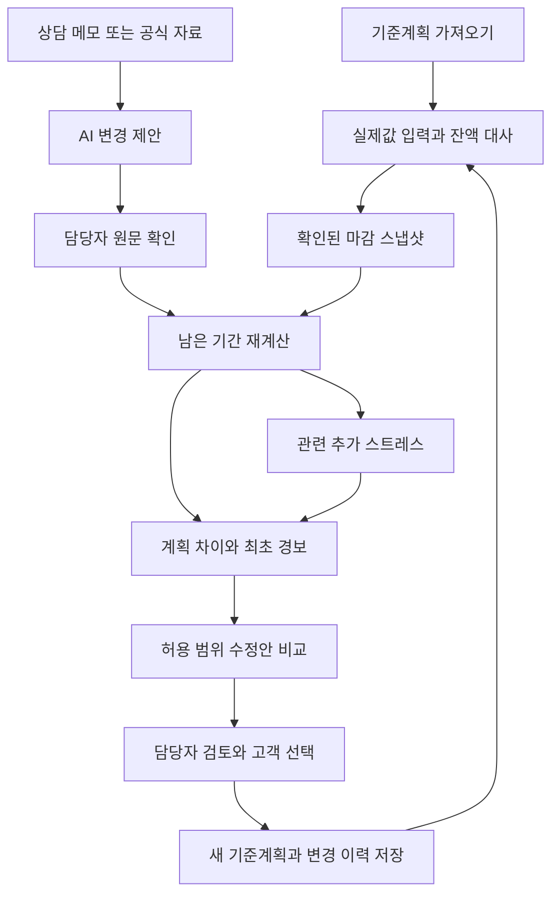

# AFPK 6단계 모니터링 시스템 구현 계획

작성 기준일 2026-11-13 KST

## 1 구현 목표

**고객의 실제 상황이 바뀌었을 때 무엇이 달라졌고, 언제 얼마가 부족하며, 기존 계획을 얼마나 바꾸면 되는지 보여주는 시스템을 만든다.** 4단계의 계산 엔진을 재사용하고, 6단계에는 실제값 입력·계획 비교·변경 확인·미래 재계산·경보·수정안 선택·이력 저장을 연결한다.

공모전의 대상은 2028년 첫 자녀 출산을 준비하는 맞벌이 가상 부부다. 아내의 회복·진료와 필수 돌봄, 비상현금, 은퇴저축을 지키면서 주택 조건을 조정한다. 주택 마련을 완료하기 전에도 출산 준비와 저축을 실행하고 점검을 시작할 수 있다.

문서 후반에 정리된 6단계의 중심은 **변경 감지 → 영향 추적 → 조기경보 → 최소 변경 재설계 → 다음 점검**이다. 처음부터 모든 재무계획을 다시 작성하거나 동일한 위험시험을 반복하는 화면으로 만들지 않는다. [D12, D22]

이 문서는 구현 계획이다. 모니터링 앱·DB·AI 연동이 이미 완성됐다는 뜻은 아니다. 기존 `stage4_system`의 계산 코드와 결과는 보존한다. 팀원용 설명은 Google Docs의 ‘모니터링 시스템 구현’ 탭에 두고, 여기에는 세부 구현 기준을 기록한다.

## 2 구현 전에 정리할 기준계획

### 2.1 450 기준과 480 기준을 별도 버전으로 관리

현재 Google Docs에는 다음 두 기준이 함께 있다. 각 기준의 결과를 한 계획의 전후 변화로 비교하면 실제 사건 때문에 달라진 것처럼 오해하게 된다.

| 항목 | 기존 4단계 실행과 1107 설정 | 새 1~5단계 합본 |
|---|---:|---:|
| 현재 생활·주거비 | 480만 원 | 450만 원 |
| 현재 출산·주택 준비 여력 | 270만 원 | 300만 원 |
| 초기 비상현금 | 3,100만 원 | 2,700만 원 |
| 기본안 역산 대출 2027 / 2030 / 2031 | 42,189 / 33,895 / 31,869만 원 | 41,499 / 33,353 / 31,366만 원 |
| 2031년 7.5억 안의 최초 매입 후 보호위반 | 2031.8 | 2031.10 |
| 6.3억 비거래 복합의 잔금일 여유 | 약 30.5만 원 | 약 517.3만 원 |
| 같은 복합조건의 최초 보호위반 | 2033.7 | 2035.2 |

합본은 2~4단계에서 450·300·2,700으로 바꾸었지만 말미 5단계에는 270·3,100이 남아 있다. 2029.6 월수지도 합본은 약 13.3/8.3, 기존 계산은 약 25.9/20.9로 다르다. 생활비 한 항목만 30만 원 줄이면 합본 전체 결과가 재현된다고 가정하지 않는다. [D19, D25, D26]

구현 첫 작업은 다음과 같다.

1. 기존 검산용 `legacy_480` 프로필을 그대로 보존한다.
2. 합본을 반영할 `combined_450_draft` 프로필을 별도로 만든다. 지출 구성, 물가 산식, 비상현금 갱신, 휴직·보육 전환, 대출 역산기간까지 항목별로 대조한다.
3. 합본의 대표값을 장부와 별도 계산으로 재현하고 차이를 기록한다. 불일치는 숫자를 맞추기 위한 임의 보정으로 없애지 않는다.
4. ‘상충결과’ 탭의 통합 방향에 따라 제출용 작업 기준은 합본의 450·300·2,700으로 정렬한다. 재계산과 팀의 확인을 마친 프로필만 점검 기준으로 등록하며, 프로필·정책·코드 버전이 같은 계획끼리 실제 변화의 영향을 비교한다. [D27]

450 프로필은 합본과 ‘상충결과’의 제출 기준을 반영하는 작업 대상이고, 480 프로필은 이미 구현한 계산의 회귀검사 기준이다. 기준을 450으로 정렬하는 것과 그 결과를 검산·활성화하는 것은 별개다. 기존 수치 일부만 교체하거나 6억 원 후보를 자동 실행안으로 올리지 않는다. [D25, D27]

### 2.2 현재 기준계획 파일은 주택 승인안이 아님

현재 [기준계획 파일](../stage4_system/outputs/latest/baseline_plan.json)은 `rent_only` 기반의 준비행동 초안이다. `draft=true`, 선택한 주택 없음, 고객 결정 없음, `housing_execution_allowed=false`로 되어 있다.

가져올 때에는 **초안 가져오기 → 입력 기준 확인 → 계획 범위 선택 → 담당자 확인 → 점검 기준 등록**을 거친다. 비상금·출산준비·은퇴저축을 위한 준비계획은 주택이 미확정이어도 점검할 수 있다. 주택 후보를 비교 대상으로 등록하는 것과 계약 실행을 허용하는 것은 별도 상태로 둔다.

6억 원·대출 1.9억 원 안도 자동 승인하지 않는다. 가상 시연은 `ACTIVE_DEMO`, 실제 운용 기준은 `ACTIVE`로 구분하고 화면에 가상 시연임을 표시한다. 시연상의 선택·확인을 실제 고객 동의나 은행 증빙으로 기록하지 않는다.

## 3 필수 기능과 확장 범위

아래 기능 ID는 이 구현 계획에서 사용하는 번호다. 원문에 적힌 확정 방향과 초기 아이디어를 구분했다.

| ID | 기능 | 최초 구현의 완료 조건 | 주요 근거 |
|---|---|---|---|
| MON01 | 기준계획 등록 | 프로필·기간·제약·입력·선택 상태가 표시되고 이전 계획을 보존 | D12, D21 |
| MON02 | 실제값 수동 입력 | 수입·지출·계좌·대출·실행내역을 금액·기간·출처와 저장 | D12, D22, D23 |
| MON03 | CSV 가져오기 | 미리보기·단위·누락·중복·대사 검사 후 확정 | D22, D23 |
| MON04 | 계획 대비 비교 | 동일 기간의 계획과 실제 차이, 미입력과 실제 0 구분 | D12, D22 |
| MON05 | 변경 제안과 확인 | 메모 추출값·적용일·근거·불명확 항목을 확인한 뒤 반영 | D11, D12 |
| MON06 | 미래 재계산 | 확정 스냅샷부터 미래만 계산하고 과거 실제는 유지 | D12 |
| MON07 | 영향 추적 | 어떤 변경이 지원금·지출·주택·대출·보호자금에 영향을 주는지 표시 | D22 |
| MON08 | 관련 스트레스 | 실제 변경 반영 전망과 추가 시험을 별도로 저장 | D11, D12 |
| MON09 | 최초 경보 | 현금 부족·보호기준·상환한도·저축·자료 누락을 구분 | D11, D12, D23 |
| MON10 | 수정안 자동 비교 | 허용된 가격·시점 후보를 규칙으로 계산하고 탈락 이유 제시 | D22, D24 |
| MON11 | 최소 변경 선택 | 고객 우선순위를 지키는 후보를 변경 폭과 함께 제시 | D22 |
| MON12 | 계획 갱신 | 담당자 검토·고객 선택을 기록하고 새 버전만 이후 점검 기준으로 사용 | D12, D22 |
| MON13 | 경보와 변경 이력 | 발생·확인·보류·해결, 근거와 계산 실행을 연결 | D12, D22 |
| MON14 | 데이터 확인일 | 마지막 확인일·자료 범위·오래된 값·미확정을 화면에 표시 | D12 |
| MON15 | AI 활용 증빙 | 실제 프롬프트·응답·수정·원문 검증·자동검사·사람 판단을 구분 | D2, D12 |
| MON16 | 시연 재현 | 사고 입력부터 경보·대안·선택·재시작까지 저장된 자료로 재현 | D22, D23 |

첫 버전은 가상 부부 한 가구를 대상으로 하는 로컬 시연 앱이다. 수동 입력·CSV·가상 메모를 중심으로 만든다. 제도 검토는 사용자가 제공한 공식 자료를 AI가 비교하고 사람이 확인하는 방식부터 시작한다.

무인 주간 자료 수집, 은행·마이데이터 연동, 금융거래 집행, 광범위한 상품 추천, 다중 고객의 외부 서비스 운영은 확장으로 둔다. 원문 초반의 몬테카를로·성공확률·투자 최적화는 검토 후보이며 6단계 필수 기능으로 올리지 않는다. [D2, D5, D11, D12]

## 4 사용자가 앱에서 하는 일

### 4.1 평소 월말 점검

1. 점검할 기준계획과 마감월을 선택한다.
2. 그달 수입·지출·저축·계좌잔액·대출잔액을 입력하거나 CSV를 올린다.
3. 시스템이 누락·중복·장부 차이를 표시한다. 확인 전에는 임시 저장한다.
4. 마감을 확정하면 계획 대비 차이와 남은 목표의 미래 전망을 계산한다.
5. 처음 부족해지는 날짜·금액과 확인할 일을 보고 필요한 경우 수정안을 비교한다.

### 4.2 상담 중 새로운 일이 생긴 경우

예를 들어 ‘아버지 사고로 치료비를 보태고 주택 지원금 일부를 받기 어려워졌다’는 메모를 입력한다. AI는 누가 얼마를 부담하는지, 언제부터 언제까지인지, 지원금은 감액인지 지연인지 정리한다. 설계사가 확인한 값만 전망에 적용한다. 이미 낸 돈은 실제 거래, 아직 낼 돈은 예정 지출로 나눈다.

### 4.3 매입 전과 매입 후

매입 전에는 아직 실행하지 않은 가격·시점·신규 대출 조건을 바꿔 볼 수 있다. 계약 후에는 이미 지급한 계약금과 계약 조건을 잠그고, 실제로 가능한 변경만 검토한다. 취득 후에는 매매가를 낮추어 과거 문제를 없애지 않는다. 남은 대출·지출·저축과 실제 가능한 조건 변경을 점검한다.

## 5 화면 구성

탭은 사용자의 업무 순서에 맞춰 여섯 개로 구성한다. 내부 해시나 DB 식별자는 상세 근거에서 확인하고 기본 화면에는 금융적 의미를 먼저 보여준다.

| 화면 | 먼저 보여줄 내용 | 주요 행동 |
|---|---|---|
| 1 이번 점검 | 기준계획, 프로필, 마감일, 자료 확인 상태, 가장 가까운 위험 | 점검 시작·불완전 자료 확인 |
| 2 실제값 입력 | 계획/실제 금액, 업로드 미리보기, 잔액 대사 차이 | 임시 저장·마감 확정 |
| 3 달라진 내용 | 변경 전후·적용일·원문 위치·확인 상태 | AI 제안 수정·반영 승인 |
| 4 앞으로의 위험 | 첫 부족일·부족 종류·부족액·원인, 잔액 그래프와 지급일 표 | 관련 시험 실행·경보 확인/보류 |
| 5 바꿔 볼 계획 | 기존안·변경 반영안·수정안의 조건과 결과 | 가격/시점 시험·후보 비교·선택 기록 |
| 6 계획과 기록 | 이전/현재 버전, 실행·변경·경보·선택 이유 | 새 기준 활성화·내보내기·시연 초기화 |

위험 화면 상단은 다음 정도로 단순하게 만든다.

```text
점검 기준  2030년 12월 말 / 가상 시연 / 480 기준
자료 상태  이번 달 계좌 대사 완료 · 대출 승인 자료 확인 필요

언제?          2031년 6월 15일
무엇이 부족?   잔금 지급 후 남길 비상·목적자금
얼마나?        재계산한 부족액
왜?            예정 지원금 감소 + 치료비 지출

[기존 계획] [변경 반영 전망] [선택한 수정안]
월별 현금과 남겨야 할 돈의 그래프
계약·잔금일의 입금 / 지급 / 지급 후 현금 / 보호여유 표
```

그래프에는 과거 실제와 미래 전망의 경계선을 그린다. 추가 스트레스는 기본 전망과 다른 선 또는 별도 영역으로 표시한다. 월말 합계 자료만 있는 기간에는 ‘월중 지급일 확인 필요’를 유지한다. 현금은 남지만 보호기준에 미달하는 경보와 실제 지급할 현금 자체가 없는 경보를 구분한다.

## 6 기술 구조

원문 제안대로 **Streamlit 화면 + Python 서비스 계층 + SQLite 저장소 + 공통 계산 엔진**으로 시작한다. 별도 프런트엔드 서버를 동시에 만들지 않는다. [D23]



Streamlit의 Session State는 화면에서 편집 중인 값과 선택 상태에만 사용한다. 영구적인 기준계획·실제값·승인·경보는 SQLite에 저장한다. 폼 제출 시 값을 모아 검증하고, 위젯 재실행이 저장·승인을 반복하지 않도록 요청 ID를 둔다. 이 구분은 Streamlit의 세션·재실행 구조와 폼 동작을 반영한 것이다. [T1, T2]

SQLite는 연결마다 외래키 제약을 활성화한다. 새 계획 활성화·활성 버전 변경·결정 기록은 하나의 트랜잭션에서 처리하고, 예상한 기준 버전이 바뀌었으면 저장을 거절한 뒤 다시 비교한다. 초기 범위는 로컬 사용이며 외부 다중 사용자 서비스의 인증·접근권한이 구현됐다고 주장하지 않는다. [T3, T4]

새 코드는 `stage6_monitoring`에 둔다. 공통 계산을 `stage4_system.afpk`에서 직접 가져오거나 경로를 한 번만 구성하는 어댑터를 사용한다. 계산 파일을 복사해 두 버전으로 따로 고치지 않는다. 공통 엔진을 확장해야 하면 기존 재현 모드를 보존하고 회귀검사를 함께 유지한다.

## 7 기존 코드에서 재사용할 부분과 새로 만들 부분

| 기존 코드 | 재사용 | 필요한 추가 작업 |
|---|---|---|
| [finance.py](../stage4_system/afpk/finance.py) | 원리금·취득비용 | 현재 대출 잔액·남은 기간·실제 금리유형 연결 |
| [config.py](../stage4_system/afpk/config.py) | 단위·유한값·날짜·입력 상태 검증 | 실제 장부·마감·프로필·경보 규칙 검증 |
| [engine.py](../stage4_system/afpk/engine.py) | 생애주기 수입·지출·보호자금 계산 | 현재 스냅샷에서 미래를 재개하는 진입점 |
| 같은 파일의 `reconcile_events` | 보조 계획/실제 부분 실행·중복 방지 | 실제 주택 계약·대출 실행 상태의 별도 모델 |
| [constraints.py](../stage4_system/afpk/constraints.py) | 현금·보호자금·저축·상환한도 판정 | 점검 실행과 경보 수명주기 연결 |
| [search.py](../stage4_system/afpk/search.py) | 명시 범위의 대출 후보 탐색 | 가격·시점·변경 폭을 포함한 수정안 탐색 |
| [storage.py](../stage4_system/afpk/storage.py) | 직렬화·입력/결과 해시 | DB 저장·불변 버전·중복 요청 방지 |
| [report.py](../stage4_system/afpk/report.py) | 표·지표·내보내기 | 실제·계획·전망·스트레스·선택안을 구분한 화면 |

**가장 큰 공백은 `forecast_from_snapshot`이다.** 현재 `simulate()`는 과거 계약일이 기준일 이전이면 거절하고, 매번 주담대·자가·정산 유보 등을 0에서 시작한다. 이미 집을 산 고객의 현재 잔액을 넣어 미래만 이어 계산하는 기능은 없다. 기존 HTML에 입력창만 붙여서는 해결되지 않는다.

현재 사건 조정도 보조 거래에 한정된다. 자동 생성 계약·잔금·대출을 보조 CSV의 실제 거래로 바꾸는 기능은 지원하지 않는다. 주택 실행은 별도 실행기록과 계약 상태로 가져와야 한다. `outputs/latest`는 생성 결과를 덮어쓰는 위치이므로 이력 저장소로 쓰지 않는다.

## 8 데이터 모델과 입력 양식

### 8.1 저장할 자료

| 객체 또는 테이블 | 핵심 필드 |
|---|---|
| 사례와 프로필 | `case_id`, `data_kind`, `profile_id`, `profile_version`, 입력·출처·정책 버전 |
| 계획 버전 | `plan_id`, `parent_plan_id`, `status`, 목표·제약·선택 조건·불변 입력·적용일 |
| 가져오기 묶음 | `batch_id`, 파일 해시·원본 행·가져온 기간·검증 결과·확정자 |
| 실제 거래 | `record_id`, 계좌·발생일·금액·유형·출처·원계획 연결·정정 연결 |
| 잔액 스냅샷 | 기준일·계좌별 잔액·주식·연금·보증금·대출·자가·현재 비상목표·과거 목표 하한·대사 상태 |
| 월마감 | 대상월·자료 범위·계좌 대사·확정 상태·스냅샷 ID |
| 실행 기록 | 계약/대출/자동이체 등의 실제일·조건·집행액·미집행액·증빙 |
| 변경 제안 | 이전/새 값·단위·적용기간·근거 위치·추출 주체·검토 상태 |
| 계산 실행 | 기준계획·스냅샷·확인된 변경·추가 스트레스·엔진 버전·해시·결과 |
| 경보 | 규칙·대상 목표·부족일·부족액·상태·원인·발견/해결 실행·담당자 |
| 점검 규칙 | 대상 지표·측정주기·재검토 조건·임계값·확인자료·대응 행동·규칙 버전 |
| 수정 후보 | 변경 항목·폭·허용 범위·수치/증빙 상태·비교 결과 |
| 결정과 활성화 기록 | 검토자·고객 선택·이유·조건·선택일·기존/새 활성 계획 |
| AI 사용 기록 | 실제 요청·응답·모델 확인정보·근거·수정·검증 주체·채택 여부 |

금액은 저장·교환 단계에서 원 단위 정수 또는 정해진 Decimal 문자열을 사용하고, 화면은 만 원으로 표시한다. 기존 엔진의 만 원 단위 변환은 어댑터 한 곳에서 한다. 변환·반올림 정책은 버전으로 고정한다.

`data_kind`는 가상 시연/실제 자료, `value_kind`는 관측값/가정/제도/예정값, `review_status`는 미검토/확인/보류/반려로 분리한다. 가상 시연 자료를 확인했다고 실제 증빙 확인값으로 승격하지 않는다.

기존 엔진이 실제 사건에 요구하는 `evidence_verified`를 가상 자료에 임의로 붙이지 않는다. `data_kind=demo`와 `review_status=confirmed`인 시연 거래는 전용 데모 어댑터로 계산하고 원기록의 가상 구분을 유지한다. 실제 운용 경로에서는 이 확인만으로 실제 거래를 반영하지 않는다.

### 8.2 CSV는 용도가 다른 세 양식으로 시작

| 양식 | 필수 열 | 계산상 역할 |
|---|---|---|
| `actual_transactions.csv` | `record_id,account_id,date,sequence,type,category,amount_krw,planned_event_id,source_id` | 실제 입출금. 내부 이체는 양쪽 계좌를 연결 |
| `balance_snapshots.csv` | `snapshot_id,account_id,as_of_date,balance_krw,source_id` | 특정 날짜의 확인 잔액. 입금으로 합산하지 않음 |
| `plan_changes.csv` | `change_id,field_path,old_value,new_value,unit,effective_from,effective_to,source_id` | 수당·복직일·예정 지원금·돌봄비 등의 변화 |

현금입금이 아닌 바우처 사용은 적격 비용과 연결한다. 은퇴저축은 현금계좌에서 연금계좌로의 이동이다. 부모의 미입금 주택 지원 감액은 미래 수입의 변경이며 이미 보유한 현금의 지출로 차감하지 않는다.

검증은 날짜·단위·기간·계좌·누락·중복·거래 연결·금액 부호·증빙 상태를 확인한다. 동일 파일 재업로드는 묶음 해시로 멱등 처리한다. 다른 파일에 같은 거래가 섞인 경우 원거래 ID를 우선 사용하고, 날짜·금액이 같다는 이유만으로 별개의 정상 거래를 자동 삭제하지 않는다. 확정한 실제 거래는 덮어쓰기보다 정정 연결로 보존한다.

### 8.3 잔액 대사와 마감

```text
예상 기말잔액 = 확인한 기초잔액 + 기간 내 입금 - 기간 내 지급
대사 차이     = 명세서 기말잔액 - 예상 기말잔액
```

대사 차이가 허용 오차를 넘거나 자료 범위가 겹치면 `NEEDS_RECONCILIATION`으로 둔다. 차이를 임의 수입·지출로 만들어 맞추지 않는다. 첫 버전의 마감 단위는 월말이다. 확정되지 않은 마감은 임시 전망에만 쓸 수 있고 검증된 최신 전망처럼 표시하지 않는다.

## 9 미래 계산을 이어 가는 방법

신규 진입점은 다음 정도로 나눈다. 이는 구현할 인터페이스이며 현재 존재하는 함수명이 아니다.

```text
import_baseline(bundle) -> draft_plan
reconcile_month(plan, actuals, statements) -> close_result
build_snapshot(close_result, execution_records) -> snapshot
confirm_changes(proposals, reviewer) -> confirmed_changes
forecast_from_snapshot(plan, snapshot, confirmed_changes, assumptions) -> forecast
run_relevant_stresses(forecast, changed_fields, templates) -> stress_runs
find_revisions(plan, snapshot, changes, allowed_changes, search_budget) -> candidates
activate_revision(expected_active_version, selection, evidence) -> new_plan_version
```

계산은 기준일의 실제 상태 확정 → 같은 기준일로 원계획 정렬 → 확인된 변경을 미래 미실행 계획에 적용 → 기본 전망 계산 → 별도 추가 스트레스 순서로 진행한다. 확인된 미래 지원금 변화가 현재 계좌잔액 자체를 바꾸지는 않는다.

- 스냅샷에는 현금·주식·연금·보증금 순지분 외에 현재 주담대 잔액, 고정/변동 금리, 예정 상환액, 남은 기간, 마지막 납입일, 자가/계약 상태, 미집행 목적자금, 누적 정산 유보, 사용한 바우처를 포함한다. 기준일의 비상현금 목표와 과거 목표 하한도 이관해 재시작으로 목표가 낮아지지 않게 한다. 비상목표 규칙 자체를 변경하려면 별도 검토·선택·버전 기록이 필요하다.
- 스냅샷 기준일까지의 실제와 집행 비용은 잠그고 이후만 전망한다. 같은 기간의 잔액과 입출금, 계획 납부와 실제 납부를 두 번 합산하지 않는다. 부분 실행은 남은 계획만 미래에 둔다.
- 매입 전·계약 후·취득 후 상태를 명시적으로 처리한다. 매각한 주식·반환된 보증금·실행한 주담대를 처음부터 다시 발생시키지 않는다.
- 고정금리 대출은 시장금리가 바뀌었다고 소급 변경하지 않는다. 변동금리는 실제 약정의 재산정일과 확인된 조건을 사용한다.
- 첫 버전은 월말 스냅샷에서 다음 달 전망을 시작한다. 월중 상담일 입력을 지원하려면 이미 받은 급여·지급한 비용과 남은 그달 거래를 분리하는 기능을 먼저 추가한다. 그전에는 단순 월말 모드를 월중 실시간 점검이라고 부르지 않는다.
- 반복 급여·납입일을 모르면 월말 근사로 계산하고 지급일 정확도를 표시한다. 확인한 중요 거래의 날짜·당일 순서만 별도 검사한다.

입력 기준일, 사건 발생일, 적용 시작일, 자료 확인일, 계산 실행일은 별도 필드다. 가상 시연의 `demo_as_of_date`가 2030년이어도 실제 실행일을 바꾸어 기록하지 않는다.

## 10 어떤 변화가 어떤 계산을 다시 실행하나

| 확인된 변화 | 다시 볼 경로 | 필요할 때 추가 시험 |
|---|---|---|
| 휴직·복직일 또는 수당 | 급여·기여금·돌봄·지원·주택자금·저축 | 추가 복직 지연, 돌봄 증가 |
| 치료비 부담 | 실제/예정 지출·현금·주택 보호여유 | 치료비 지원기간 연장 |
| 부모 주택 지원 감소·보류 | 미입금 예정 유입·계약/잔금 자금 | 남은 지원 지연 |
| 보증금 반환일·갱신액 | 순반환액·주거비·지급일 부족 | 반환 1/3개월 지연 |
| 신규 대출 조건 | 원리금·비상목표·상환부담·미래 월수지 | 확인된 후보의 금리 상승 |
| 기존 고정대출의 시장금리 | 정보 표시. 원계약 상환표 유지 | 고정금리 소급 충격은 금지 |
| 지원제도 변경 | 적용일부터 해당 지원·적격성 | 시행·자격 미확정은 확인 필요 |

변경 항목과 연결된 경로를 표시하되, 첫 구현의 수치 계산은 전체 남은 기간을 다시 실행해도 된다. 한 가구 모델에서 섣부른 부분 캐시보다 계산 누락을 막는 것이 우선이다. ‘관련 계산을 선택’하는 것과 원인 추적은 연결표로 구현하고, 계산 속도 최적화는 측정 후 한다.

계획 차이는 같은 기간·단위·프로필끼리 계산한다. 변경별 단독 영향과 복합 영향이 다르면 상호작용을 별도로 표시한다. 단독 효과를 단순 합산해 최저 보호여유 감소의 원인을 전부 설명했다고 쓰지 않는다.

## 11 경보 상태와 계획 변경

### 11.1 경보는 수치와 자료 상태를 함께 보여준다

| 경보 | 표시할 값 |
|---|---|
| 현금 지급불능 | 첫 지급일, 현금 부족액, 지급·확정 유입 구성 |
| 보호자금 미달 | 첫 위반일, 총현금, 비상/목적자금 구성, 부족액 |
| 고객 합의 상환한도 초과 | 합의 범위의 부채·정기소득·한도·적용기간 |
| 은퇴저축 미달 | 목표와 실제/예정 납입, 감액 기간·복원계획 확인 여부 |
| 반복 월적자 | 시작월·지속기간·남은 현금 경로. 보호기준 통과와 분리 |
| 입력 누락·오래된 자료 | 누락 항목·마지막 확인일·점검에 미치는 범위 |

자료가 없다고 0으로 채우지 않는다. 자료 부족은 `UNKNOWN`, 노후 충분성 등 범위 밖 평가는 `NOT_EVALUATED`로 남긴다. 알려진 수치 조건을 통과해도 미확인 조건까지 충족한 것은 아니다. 자료 유효기간은 항목별 설정으로 관리하고 시연 날짜를 기준으로 평가한다.

경보는 `OPEN → ACKNOWLEDGED / DEFERRED → RESOLVED` 흐름으로 관리한다. 확인·보류는 해결이 아니다. 새 실행이 같은 규칙·목표·전망 구간에서 부족을 해소했을 때에만 해결 근거를 연결한다. 과거 실제로 위반한 사건은 없애지 않고 현재 전망과 구분해 보존한다. 재발하면 이전 경보와 연결한 새 발생 이력을 만든다.

경보 묶음은 사례·목표·규칙·원인 사건을 기준으로 연결하고, 실행별 발생 내역에 당시 부족일·금액·계획 버전을 저장한다. 같은 입력 재실행으로 경보를 중복 생성하지 않는다. 부족 예상일이 이동하면 기존 묶음의 최신 상태를 갱신하되 과거 관측은 보존한다. 분석 종료월을 앞당겨 이전 위반일을 제외했거나 자료가 사라졌다는 이유로 해결 처리하지 않는다.

### 11.2 활성 계획 갱신

계획 상태는 `DRAFT → REVIEWED → ACTIVE → SUPERSEDED`로 둔다. 데모는 대응하는 `*_DEMO` 상태와 자료 구분을 사용한다. 주택 계약 실행 허용, 자료 확인 상태, 계획의 점검용 활성 상태는 서로 다른 필드다.

수정안 선택 시 기존/새 계획 차이, 참가자의 검토, 고객 선택, 남은 조건, 적용일, 근거 계산을 저장한다. 승인 버튼을 누를 때 본 기준계획·실제값 버전이 달라졌으면 다시 계산해야 한다. 새 버전 저장과 활성 포인터 변경·결정 기록이 모두 성공하거나 모두 취소되도록 처리한다.

## 12 최소 변경 수정안 탐색

후보는 Python 규칙으로 생성한다. AI는 빠진 영향과 바꿔 볼 방향을 보조하며 후보의 수치를 만들어 내지 않는다.

1. 의료·회복·필수 돌봄, 고객이 합의한 치료비 지원, 비상현금, 은퇴저축의 유지 조건을 먼저 고정한다.
2. 아직 실행하지 않은 주택의 가격·시점부터 변경한다. 시연 후보는 6억·5.8억·5.6억 및 구입 연기다. 실제 최소 주거조건과 임차 연장 가능성은 별도 확인한다.
3. 모든 후보에서 부대비용·상환액·비상현금·계약/잔금일·매입 후 기간을 재계산한다. 가장 늦은 구입 후보의 취득 후 5년까지 자료를 확보하고, 공통 날짜 비교와 각 안의 매입 후 5년 평가를 함께 표시한다. 대출 고정 비교와 대출 변경 비교를 구분한다.
4. 수치상 불가능한 안, 증빙 확인이 남은 안, 비교한 범위에서 수치를 충족한 안을 분리한다. 모든 후보에 미확인 대출을 추가해 부족을 지우지 않는다.
5. 고객이 정한 변경 순서에 따라 변경 항목 수, 매입 연기 폭, 가격 차이 등을 차례로 비교한다. 가격과 시점 중 무엇을 더 지킬지는 허용 조건에 기록한다. 임의의 가중치를 숨긴 ‘최적안’으로 표시하지 않는다.
6. 검사한 후보 중 가장 작은 변경이라고 설명한다. 격자 밖까지 전역 최적이라고 주장하지 않는다. 예산 소진은 탐색 미완료, 전체 허용 후보 실패는 그 범위에서 해 없음으로 표시한다.
7. 은퇴저축 감액은 주택 조건 조정 이후 고객이 기간·한도·복원계획을 합의한 별도 안으로만 검토한다.

이미 실행한 가격·날짜·고정금리 등은 후보 생성 단계에서 잠근다. 현재 범위를 넘어 목표·우선순위 자체를 바꿔야 하면 ‘4단계 재수립 필요’로 넘긴다. 단순 보호여유 양수뿐 아니라 반복 월적자와 데이터 정확도도 후보 옆에 유지한다.

## 13 AI 변경 추출과 검증

AI 입력은 필요한 메모·자료 발췌, 현재 계획의 관련 값, 허용 변경 범위로 제한한다. 가상 자료를 우선 사용하고 실제 자료를 쓰게 되면 불필요한 식별정보를 입력하지 않는다. 문서의 지시문을 실행 명령으로 취급하지 않고 근거 데이터로만 읽는다.

AI 응답은 `field_path`, `old_value`, `proposed_value`, `unit`, `effective_from/to`, `source_quote`, `source_location`, `uncertainties`의 구조로 받는다. 허용 필드·유형·범위·출처 위치를 프로그램이 검사하고, 사람이 원문을 확인한 뒤 `confirmed_change`로 바꾼다. DB의 실제값이나 활성 계획을 AI 응답이 직접 수정하지 않는다.

‘주택 지원 보류’는 새 입금일이 없으면 무기한 보류로 정리한다. ‘휴직 연장’은 수당·복직일·공제·보육 조건이 확인되기 전 유급 또는 무급으로 단정하지 않는다. 사람은 추출값을 수정·반려·보류할 수 있다.

실제 모델이 연결되지 않았거나 응답이 실패하면 수동 입력으로 같은 흐름을 완료할 수 있어야 한다. 사전 저장 AI 응답으로 테스트할 때는 목업이라고 표시한다. 실제 연동 여부와 사용 도구·모델·프롬프트·응답·수정·검증 시간을 기록한다. 자동 검사와 참가자의 직접 확인을 섞지 않는다. [D2, D6, D11, D12]

## 14 공모전 시연 시나리오

### 14.1 아버지 사고 사례

원문 시연은 2030년 12월 남편 아버지의 사고로 시작한다. 치료·재활·간병비 월 400만 원 중 남편 부모가 300만 원, 부부가 100만 원을 6개월 부담한다. 남편 부모의 주택 지원 5,000만 원은 보류되고 아내 부모의 지원은 유지된다. [D22, D23]

시연 순서는 다음과 같다.

1. 프로필·입력·대출·분석기간이 고정된 가상 기준계획을 등록한다. 6억 원·대출 1.9억 원 안을 실제 승인안으로 표시하지 않는다.
2. 가상 월마감 자료를 넣어 잔액을 대사한다. 자료는 시연용으로 만든 값임을 표시한다.
3. 사고 상담 메모를 넣고 AI가 치료비 부담자·기간·주택 지원 변화를 추출한다.
4. 담당자가 확인하면 실제로 낸 금액과 남은 치료비 계획, 남편 부모 지원금의 입금 보류를 나누어 반영한다. 지원 약정액 5,000만 원은 보류 상태로 보존하고 입금일 미확정으로 해당 잔금재원에서 제외한다. 영구 취소로 바꾸지 않으며 새 입금일이 확인되면 변경을 등록한다.
5. 기존 전망과 변경 후 전망을 비교해 첫 경보·부족액·원인을 표시한다.
6. 추가 위험으로 치료비 지원 3개월 연장, 신규금리 7%, 2031.6부터 돌봄비 20% 상승, 매각대금 20% 하락을 시험한다. 기본 변경과 구분해 저장한다.
7. 6억·5.8억·5.6억·구입 연기를 비교하고 고객의 선택·조건을 기록한다.
8. 새 계획으로 재시작해 이전 버전·발생 경보·수정 근거가 보존되는지 보여준다.

사고가 발생한 첫 상담일에 치료비 600만 원을 이미 쓴 것으로 입력하고 미래 6개월 비용까지 또 차감하지 않는다. 처음 1개월만 지출했다면 실제 100과 예정 500으로 나눈다. 치료비 600과 잔금 때 받을 것으로 보던 지원금 5,000의 미조달을 합한 5,600은 해당 시점 주택재원의 차이다. 현재 계좌에서 5,600이 인출됐거나 지원금이 영구 취소됐다는 뜻이 아니다.

### 14.2 원문 숫자는 검산할 시연 목표

다음은 ‘모니터링 시스템’ 탭에 제시된 값이다. 현재 4단계 프로그램이 사고 사례 전체를 재현했다는 뜻은 아니다.

| 480 계열 원시연의 가격 | 사고 후 잔금일 보호여유 | 원문 추가위험을 넣은 매입 후 최저 여유 |
|---|---:|---:|
| 6억 | 약 -1,998만 원 | 약 -3,156만 원 |
| 5.8억 | 약 +33만 원 | 약 -1,125만 원 |
| 5.6억 | 약 +2,064만 원 | 약 +906만 원 |

입력·적용월·비용·금리·보호자금의 상세 장부를 재구성해 이 목표를 검산한다. 특히 2031.6.15 첫 경보와 2036.6까지 5.6억 안의 경로를 확인한다. 450 프로필에서는 별도 계산한 값을 사용하며 원문 숫자에 억지로 맞추지 않는다.

기존 4단계의 ‘비거래 복합’은 치료비·지원금 감소가 없고 돌봄 상승 시작도 다르다. 그 시험을 사고 사례의 검증으로 재사용하지 않는다. 다른 화면의 906 또는 491 같은 숫자만 떼어 같은 조건이라고 설명하지 않는다.

### 14.3 시연에 함께 넣을 반례

- 월말 현금은 충분해도 잔금일 입금 순서 때문에 부족한 사례.
- AI가 ‘남편 부모 300, 부부 100’을 잘못 읽으면 검토 화면에서 수정하는 사례.
- 기존 고정금리 대출이 있어도 시장금리만 바뀌었다는 이유로 과거 상환액이 달라지지 않는 사례.
- 자료가 누락되면 안전으로 표시하지 않고 확인 필요로 남는 사례.
- 실행한 주택의 가격을 낮추는 수정이 거절되고, 아직 미실행인 조건만 바꾸는 사례.

## 15 구현 순서와 완료 판정

각 단계는 화면 수가 아니라 끝까지 실행되는 업무 흐름으로 완료를 판정한다. 날짜와 담당자 배분은 실제 작업 여건에 맞추어 정한다.

| 순서 | 작업 묶음 | 완료 기준 |
|---|---|---|
| P0 | 입력 기준·계획 상태 정리 | 450/480 비교표, 프로필별 재현 근거, 선택 주택과 준비계획 구분 |
| P1 | 저장소·가져오기·실제값·월마감 | CSV 중복 방지, 계좌 대사, 확정 스냅샷, 재시작 후 자료 유지 |
| P2 | 스냅샷 미래 계산 | 미매입·계약 후·취득 후 세 상태, 현재 부채·목적자금, 과거 잠금 |
| P3 | 차이 비교·관련 시험·경보 | 기본/추가시험 분리, 최초 위반·부족 종류·자료 확인 상태 표시 |
| P4 | 수정안·선택·버전 활성화 | 허용 후보 비교, 실행 조건 잠금, 동시 변경 충돌과 트랜잭션 처리 |
| P5 | AI 변경 추출·검토·증빙 | 실제 모델 또는 목업 구분, 원문 확인, 실패 시 수동 완료 |
| P6 | 사고 시연·회귀·내보내기 | 처음 입력부터 새 계획 재시작까지 재현, 같은 결과의 장부·보고서 |

화면은 P1부터 얇게 연결하되, 화면을 꾸미기 전에 P2의 상태 재시작을 검증한다. 첫 수직 구현은 ‘준비계획 등록 → 1개월 마감 → 변경 1개 → 경보 1개 → 수정 1개 → 새 버전 재시작’이다. 이후 위험과 시연을 늘린다.

제안 폴더 구조는 다음과 같다. 이 계획 파일 외의 모듈은 아직 작성하지 않았다.

```text
stage6_monitoring/
  6단계_모니터링_시스템_구현계획.md
  app.py
  monitoring/
    baseline_import.py
    profiles.py
    actuals.py
    reconciliation.py
    snapshots.py
    forecast_adapter.py
    change_service.py
    stress_router.py
    alert_service.py
    replanning.py
    plan_versions.py
    repository.py
    ai_adapter.py
    exports.py
  templates/                 # 실제거래·잔액·변경 CSV
  fixtures/                  # 시연 전용 자료와 예상 장부
  migrations/                # SQLite 스키마 버전
  tests/
  data/                      # 로컬 DB, 외부 전송 없이 관리
  outputs/<monitoring_run>/   # 실행별 불변 결과, latest를 이력으로 사용하지 않음
```

## 16 구현 시 반드시 통과할 검사

| 검사 묶음 | 대표 인수 조건 |
|---|---|
| 기준계획 | 초안이 자동 승인되지 않음. 준비계획은 주택 미확정이어도 점검 가능 |
| 프로필 | 450/480 혼합 거절, 모델/정책 변경을 실제 소비 변화로 오인하지 않음 |
| CSV | 중복 재업로드 멱등, 정상적인 같은 금액 거래 보존, 단위 오류 차단 |
| 잔액 대사 | 명세서 잔액과 기간 거래가 일치, 차이는 미해결로 남음 |
| 실제와 계획 | 실제 일부 납부만큼 미래 계획 차감, 스냅샷 이전 재가산 없음 |
| 자산 이동 | 연금이체·보증금 반환·주식매각·바우처를 새 현금소득과 혼동하지 않음 |
| 과거 잠금 | 실행 계약 가격·날짜·고정금리가 후보 탐색으로 바뀌지 않음 |
| 스냅샷 | 기존 대출·자가·미집행 목적자금·정산 유보를 0으로 초기화하거나 비상목표 하한을 낮추지 않음 |
| 재시작 | 같은 스냅샷·변경·버전에서 결과가 같고 이미 실행한 사건이 재발생하지 않음 |
| 시간 정확도 | 월말 근사와 등록된 지급일, 마감 기준일과 실제 실행일 구분 |
| 조건 판정 | 현금 부족·보호 미달·월적자·상환·자료 누락·노후 미평가 분리 |
| 경보 | 확인/보류만으로 해결되지 않음. 해결 실행과 과거 위반 기록 보존 |
| 후보 탐색 | 허용 범위·잠금 준수, 증액 대출의 미확인 상태 유지, 예산 소진 구분 |
| 버전 | 활성화 도중 실패하면 전부 취소, 오래된 버전의 승인 거절 |
| 사고 처리 | 부부 부담 100만 반영, 실제/예정 600 중복 없음, 지원 5,000은 미래 유입 감소 |
| AI | 잘못된 기간·금액·단위 거절, 원문 확인 전 미적용, 목업/실제 구분 |
| 데모 자료 | 확인된 가상 거래가 데모 계산에는 반영되지만 실제 증빙 확인값으로 승격되지 않음 |
| 지속 사용 | 앱 종료·재시작 후 계획·마감·경보·선택 이유가 유지 |
| 회귀 | 기존 4단계 검사 39개 유지, 새 어댑터와 승인·저장소 검사를 추가 |

숫자 비교는 같은 코드가 생성한 두 출력의 일치로 끝내지 않는다. 대표 원리금·비용·사고 현금 감소는 별도 수식과 원문으로 확인한다. 수작업과 AI 보조 비교를 한다면 자료정리·계산·보고서·AI 결과 검증/수정 시간을 모두 기록하고 실제 측정 전 절감률을 적지 않는다. [D6]

## 17 근거와 전 탭 검토 범위

Google Docs는 2026-11-13 최초 계획 시 26개 탭을 확인했고, 팀 설명본을 작성하며 추가된 ‘상충결과’와 작성 대상인 ‘모니터링 시스템 구현’까지 28개 탭의 구성을 확인했다. 새 ‘상충결과’의 제출 기준 정렬 방향을 2절에 반영했다. 아래 목록은 요구사항 추적용이며 초기 아이디어를 모두 구현해야 한다는 뜻은 아니다. 링크는 해당 탭으로 연결한다.

| ID | 탭 | 계획에 반영한 역할 |
|---|---|---|
| D1 | [1~3단계](https://docs.google.com/document/d/1FFDyGXzR25NgBZ-fxijBPt8g2lSlLKEExJjPv9n1_hY/edit?tab=t.o1hrd950vv7t) | 내용 없는 상위 묶음, 하위 탭 확인 |
| D2 | [1007-규리](https://docs.google.com/document/d/1FFDyGXzR25NgBZ-fxijBPt8g2lSlLKEExJjPv9n1_hY/edit?tab=t.0) | 고객·서비스·지표·AI 책임과 검증, 몬테카를로 후보 구분 |
| D3 | [1028-규리](https://docs.google.com/document/d/1FFDyGXzR25NgBZ-fxijBPt8g2lSlLKEExJjPv9n1_hY/edit?tab=t.x0xl12xjisp2) | 고객·소득·주택·장기 목표의 초기 후보 |
| D4 | [1010-혜원](https://docs.google.com/document/d/1FFDyGXzR25NgBZ-fxijBPt8g2lSlLKEExJjPv9n1_hY/edit?tab=t.xwx4skkkzcz9) | 위험과 분석·AI 활용 아이디어의 발전 과정 |
| D5 | [1028 - 혜원](https://docs.google.com/document/d/1FFDyGXzR25NgBZ-fxijBPt8g2lSlLKEExJjPv9n1_hY/edit?tab=t.740d1qo72r7q) | 서비스·지표·AI 후보, 후속 확정 범위와 분리 |
| D6 | [1029 - 회의](https://docs.google.com/document/d/1FFDyGXzR25NgBZ-fxijBPt8g2lSlLKEExJjPv9n1_hY/edit?tab=t.8monzajdvuxv) | 수작업/AI 보조 비교와 검증·수정시간 측정 |
| D7 | [1029-규리](https://docs.google.com/document/d/1FFDyGXzR25NgBZ-fxijBPt8g2lSlLKEExJjPv9n1_hY/edit?tab=t.j3xa49rjum3a) | 고객이 정할 조건과 계산으로 얻을 결과 분리 |
| D8 | [1101 - 혜원](https://docs.google.com/document/d/1FFDyGXzR25NgBZ-fxijBPt8g2lSlLKEExJjPv9n1_hY/edit?tab=t.kaa0e463c2ne) | 가상 고객·자료·목표·최종 고객 판단 |
| D9 | [1102 - 규리](https://docs.google.com/document/d/1FFDyGXzR25NgBZ-fxijBPt8g2lSlLKEExJjPv9n1_hY/edit?tab=t.5r3j7lvn1yb9) | 초기 출처·서비스·확인자료·은퇴 분석 범위 |
| D10 | [본문](https://docs.google.com/document/d/1FFDyGXzR25NgBZ-fxijBPt8g2lSlLKEExJjPv9n1_hY/edit?tab=t.inynhdmao49b) | 내용 없는 본문 묶음, 하위 최종 확인 |
| D11 | [1104 혜원 AI 사용 흐름](https://docs.google.com/document/d/1FFDyGXzR25NgBZ-fxijBPt8g2lSlLKEExJjPv9n1_hY/edit?tab=t.8x9nt5pldvwj) | 필수/보조 기능, 관련 스트레스, 제도 자동화 범위 |
| D12 | [1104 규리 재무설계 프로세스와 AI](https://docs.google.com/document/d/1FFDyGXzR25NgBZ-fxijBPt8g2lSlLKEExJjPv9n1_hY/edit?tab=t.m02vjoyvlj6y) | 4·5·6 구분, 기준계획·실제·변경·경보·승인·책임 |
| D13 | [앙딱정](https://docs.google.com/document/d/1FFDyGXzR25NgBZ-fxijBPt8g2lSlLKEExJjPv9n1_hY/edit?tab=t.hs0gzc3k0u5k) | 공유 계산과 점검·선택·버전의 간단한 흐름 |
| D14 | [항목들 + 주택 구입 절차](https://docs.google.com/document/d/1FFDyGXzR25NgBZ-fxijBPt8g2lSlLKEExJjPv9n1_hY/edit?tab=t.kxnvfprcdalw) | 초기 450 지출·휴직·거래일, 후속 설정과 대조 |
| D15 | [4단계 초안 작성 완료](https://docs.google.com/document/d/1FFDyGXzR25NgBZ-fxijBPt8g2lSlLKEExJjPv9n1_hY/edit?tab=t.6wh5b1eqar7z) | 기존 비교·시험의 출발점 |
| D16 | [4단계 검토 ㅎㅎ](https://docs.google.com/document/d/1FFDyGXzR25NgBZ-fxijBPt8g2lSlLKEExJjPv9n1_hY/edit?tab=t.coau5uitotvj) | 장기 검증·보호자금 구성·세부 장부·26/21 구분 |
| D17 | [4단계 피드백 반영본](https://docs.google.com/document/d/1FFDyGXzR25NgBZ-fxijBPt8g2lSlLKEExJjPv9n1_hY/edit?tab=t.iznjxipa278x) | 480 계열의 수정 판단과 조건 |
| D18 | [고객 정보 및 1~3단계 최종](https://docs.google.com/document/d/1FFDyGXzR25NgBZ-fxijBPt8g2lSlLKEExJjPv9n1_hY/edit?tab=t.7b6w3spna1f3) | 원래 고객·자산·목표·450 기준과 장기 미평가 |
| D19 | [1107-규리 항목정리](https://docs.google.com/document/d/1FFDyGXzR25NgBZ-fxijBPt8g2lSlLKEExJjPv9n1_hY/edit?tab=t.gipt65gh5bum) | 480 프로필·돌봄·휴직·보호자금·지급일·출처 |
| D20 | [스토리텔링 제안](https://docs.google.com/document/d/1FFDyGXzR25NgBZ-fxijBPt8g2lSlLKEExJjPv9n1_hY/edit?tab=t.eb1rmjivavp4) | 아내의 회복·진료·돌봄을 우선하는 고객 맥락 |
| D21 | [1110 규리](https://docs.google.com/document/d/1FFDyGXzR25NgBZ-fxijBPt8g2lSlLKEExJjPv9n1_hY/edit?tab=t.7clkvywcazky) | 준비행동부터 실행·증빙·점검 인계 |
| D22 | [1110 6단계 규리](https://docs.google.com/document/d/1FFDyGXzR25NgBZ-fxijBPt8g2lSlLKEExJjPv9n1_hY/edit?tab=t.cwhez27lo93u) | 사고 사례와 후반의 변경관리·최소변경·CSV·규칙 탐색 |
| D23 | [모니터링 시스템](https://docs.google.com/document/d/1FFDyGXzR25NgBZ-fxijBPt8g2lSlLKEExJjPv9n1_hY/edit?tab=t.ysojydkiem4) | 입력·화면·Streamlit/SQLite·시연 목표값 |
| D24 | [1110 혜원 수정 계획](https://docs.google.com/document/d/1FFDyGXzR25NgBZ-fxijBPt8g2lSlLKEExJjPv9n1_hY/edit?tab=t.75fk81fc3m1h) | 4.5 선택 근거·수치 통일·4/6 중복 해소 |
| D25 | [1~5단계 합본](https://docs.google.com/document/d/1FFDyGXzR25NgBZ-fxijBPt8g2lSlLKEExJjPv9n1_hY/edit?tab=t.q2unc6eh9p57) | 450 프로필·재계산 제시값·말미 5단계 불일치 |
| D26 | [4단계돌린결과](https://docs.google.com/document/d/1FFDyGXzR25NgBZ-fxijBPt8g2lSlLKEExJjPv9n1_hY/edit?tab=t.rsl3irm83hw7) | 실제 구현의 480 결과·6억 조건부 후보·시험 범위 구분 |
| D27 | [상충결과](https://docs.google.com/document/d/1FFDyGXzR25NgBZ-fxijBPt8g2lSlLKEExJjPv9n1_hY/edit?tab=t.nrvoo0amh59x) | 제출은 합본 기준으로 정렬, 6억 이하 후보 재계산, 임차 유지와 조건부 재심사 |
| D28 | [모니터링 시스템 구현](https://docs.google.com/document/d/1FFDyGXzR25NgBZ-fxijBPt8g2lSlLKEExJjPv9n1_hY/edit?tab=t.gey3fkp7eqou) | 이 계획을 팀원에게 쉽게 설명해 기록할 대상 탭. 최초 확인 시 비어 있었음 |

기술 근거는 공식 문서에서 확인했다. 특정 버전 번호는 구현 환경에서 설치·검증한 뒤 고정한다.

- T1 [Streamlit Session State](https://docs.streamlit.io/develop/concepts/architecture/session-state) — 세션 상태·재실행과 영구 저장의 역할 구분.
- T2 [Streamlit 폼](https://docs.streamlit.io/develop/api-reference/execution-flow/st.form) — 제출 시 입력을 묶어서 처리.
- T3 [SQLite 외래키](https://www.sqlite.org/foreignkeys.html) — 연결별 외래키 활성화.
- T4 [SQLite 트랜잭션](https://www.sqlite.org/lang_transaction.html) — 활성화의 일괄 처리·쓰기 충돌.

## 18 계획 검토 기록

이 기록은 계획의 검토이며 앱의 구현·테스트 완료를 뜻하지 않는다.

1. 원문 범위 대조: 전체 탭에서 초기 후보와 후속 구현 방향을 분리하고 필수·확장 기능을 구분했다. 450/480과 합본 내부 5단계 불일치를 확인했다.
2. 코드 연동 대조: 기존 엔진의 매입 후 초기 상태와 스냅샷 재시작 공백, 보조 사건 범위, 초안 기준계획·덮어쓰기 출력을 확인했다.
3. 구현 흐름 검토: 입력·마감·현재 상태·경보·수정·선택·버전 전환을 독립 검토했다. 비상현금 목표 하한의 이관과 가상 자료 전용 확인 경로를 보완하고, 지원금 보류를 영구 감액과 구분했다. 기능 16개·전체 탭 목록·표 구조·로컬 링크·코드블록을 점검했다. 추가된 ‘상충결과’는 제출용 기준 정렬에 반영하고, 팀 설명 대상 탭은 계산 근거와 구분했다.
